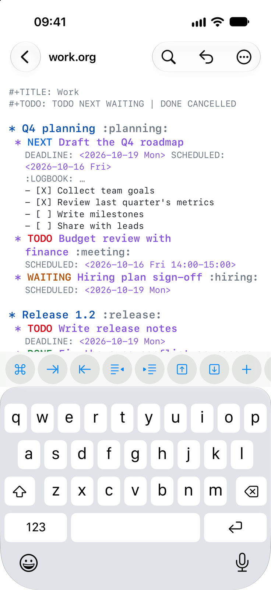

#+TITLE: iPhone and iPad
#+DESCRIPTION: The iOS app: folders, reading and editing, search, the agenda, widgets, capture, clocking, notifications, export and settings.
#+LEDE: orgstar for iPhone and iPad reads and edits the same org files as the Mac, with the agenda, capture and search.

* Overview

On first launch, a few screens introduce the app, ask for the folder of org files, and offer notifications, Calendar events and Reminders. Each permission is asked for only when you tap Continue on its screen; Not Now skips it, and every one can be changed later in Settings. The Calendar and Reminders screens say when the feature needs orgstar+. With Reduce Motion on, the screens fade into each other instead of sliding. The app has three tabs, and opens on Folders until a folder has been added:

- Agenda :: the agenda over your folders, with capture.
- Folders :: the folders of org files you added. Each shows its subfolders and org files; tap a subfolder to open it.
- Settings :: where the app's settings come from.

The search button (the magnifying glass) at the top right of Agenda and Folders opens Search.

On an iPad, and in an iPad window wide enough, a sidebar takes the place of the tabs: Agenda, Search, All Folders and each added folder on its own row, and Settings. In a narrow window, such as Slide Over or a narrow split, the tabs come back.

Files open in a reader first. The Edit button in the reader opens the editor. Both use the same open file, so an edit in the editor shows in the reader when you go back.

* Folders and file access

orgstar on iOS works on folders you choose, in iCloud Drive or in another app's storage (for example a folder kept by a Syncthing client).

1. Open the Folders tab and tap Add Folder (the folder icon with a plus).
2. Choose a folder in the picker.

orgstar keeps access to the folder across launches. Each folder appears as a section listing its =.org= files by their path inside the folder. To stop using a folder, tap the ⋯ button beside its name, or touch and hold the name, and choose Remove from orgstar…; orgstar asks first. The folder and its files stay where they are. An added folder that is empty also has Delete Folder…, which deletes it from disk too.

Swipe left on a file, or touch and hold it, to delete it. orgstar asks first. A file in iCloud Drive goes to Recently Deleted in the Files app; elsewhere it is removed. New File… and New Folder… under + at the top right make one in the folder shown, or with several added folders, in the one you pick; a file name without an extension gets =.org=. New File from Template… there asks for a template from =snippets.toml= in the configuration folder and a name, then opens the new file in the editor with the template expanded; see [[*Snippets][Snippets]]. Empty folders are listed too and delete the same way; a folder with anything in it other than hidden files can't be deleted from orgstar.

Files that iCloud hasn't downloaded to the device yet appear in grey with a cloud icon. orgstar asks iCloud to download them and lists them as files once they arrive; tap one to ask for it at once, and a spinner shows until it arrives.

orgstar sees changes made by iCloud and by apps that use the system's file coordination, and reads every folder again each time you return to the app, since not every sync app reports its changes. An open file takes in changes from disk as described in [[file:15-alongside-emacs.org][Working alongside Emacs and other tools]].

There is no way to open a single file from the Files app. Add the folder that contains it.

* The reader

Tap a file in Folders or Search, or Open in File in an agenda entry's sheet, to read it.

- Tap a heading to fold or unfold it, as =TAB= cycles it on the Mac. A chevron marks headings with content.
- The file opens with the visibility its =#+STARTUP= line asks for, then each heading's =VISIBILITY= property when =#+STARTUP= sets a visibility. Drawers and blocks are folded as =org-cycle-hide-drawer-startup= and =org-cycle-hide-block-startup= say, or as the file's =#+STARTUP= says (=hidedrawers=, =nohideblocks= and the like). Tap a folded drawer's first line or its =…= to open it, and the first line again to fold it.
- Text is styled as in the editor, in the theme's colours, font, size, line spacing and heading sizes, on the theme's background: TODO keywords, priorities, tags, emphasis, code, timestamps, links, and the code in src blocks. Text can be selected and copied.
- The reader follows the editor's display settings (see Themes and display below): Show Markup, hidden emphasis markers, pretty entities, indentation, leading stars, inline images and truncated lines. Tables show at full width, without narrowed columns.
- Tap a link to follow it. Links to headings and files in your folders open in the reader; links to other files, such as an attached PDF or image, open in Quick Look; web links open in the browser.
- The toolbar has Find, Edit (the pencil) and Commands, which has Outline (a list of headings to jump to) and Export… as well; see Commands below.
- Tags aligned with spaces show at the right edge of the heading's line, or on a line of their own at the right when the heading wraps (see [[file:02-the-editor.org][The editor]], Wrapping and filling).
- Find opens the system find bar over the file's text. Results are marked, and the one shown is unfolded and scrolled to.

* The editor

Tap Edit in the reader. The title shows the buffer name, with =•= while there are unsaved changes. The tab bar is hidden while you edit.

The editor folds headings, drawers and blocks (tap a fold's =…= to open it, and an open drawer's first line to fold it), styles text with the theme from the configuration folder (see Themes and display below), and runs the same Org commands as the Mac. Autocorrection, smart quotes and smart dashes are off; spell checking follows =spell-check= in =config.toml= and is off by default; it leaves out code, links, dates, tags and keywords, as on the Mac. Word Count in Commands shows the words, characters and reading time of the selection, or of the file.

The toolbar has:

- Conflict :: shown while the file and your edits conflict; opens the conflict sheet.
- Find :: the system find bar. The result shown is selected, and opened when it is in folded text.
- Resolve Sync Conflicts… :: shown while the file has Syncthing conflict copies; see Conflicts below.
- Recovery Versions… :: on iPad, shown while the recovery folder holds versions of the file; see Conflicts below.
- Undo :: touch and hold it for Redo.
- Export :: on iPad, the export formats; see Export below.
- Commands :: every command; see Commands below.

On iPhone, Recovery Versions…, Export… and Export Subtree… are in Commands, so the file name has room at every text size.

The key bar holds what you repeat at the caret while typing, the toolbar what acts on the whole file, and Commands everything else.

Messages from commands show at the top of the editor and the column view, and at the bottom of the reader, the agenda and the board, for a few seconds; tap one to dismiss it. VoiceOver reads each message as it appears. An error opening, saving or reading a file shows what failed on its first line, such as =Couldn't Save File=.

** Panes and windows on iPad

On iPad, the editor can show a file in several panes, as a Mac window does (see [[file:01-files-and-folders.org][Files and folders]]):

| Command           | Where                                     | Emacs keys | Does                                                                   |
|-------------------+-------------------------------------------+------------+------------------------------------------------------------------------|
| Split Pane Right  | Commands, View menu, a hardware keyboard  | =C-x 3=    | Halves the focused pane side by side; the new pane shows the same file |
| Split Pane Below  | Commands, View menu, a hardware keyboard  | =C-x 2=    | Halves the focused pane one above the other                            |
| Next Pane         | Commands, View menu, a hardware keyboard  | =C-x o=    | Moves focus to the next pane                                           |
| Close Pane        | Commands, View menu, a hardware keyboard  | =C-x 0=    | Closes the focused pane                                                |
| Close Other Panes | Commands, View menu, a hardware keyboard  | =C-x 1=    | Closes every pane but the focused one                                  |

The focused pane has a line along its top and the toolbar acts on it; tap in a pane to focus it. Drag the line between two panes to resize them; with VoiceOver, swipe up or down on it. Every pane shows the same buffer: text typed in one shows in the others at once, and folds, narrowing and styles are the buffer's. The caret and scroll position are each pane's own, and so is undo: Undo in a pane undoes what was typed or changed in that pane. A link to another file opens it on its own screen, leaving the panes as they are.

Each iPad window (scene), opened from the app switcher or by dragging the app from the Dock, has its own tabs, screens and panes over the same open files, so a file edited in one window shows the edit in the others. The pane commands aren't offered on iPhone or in a narrow window. Close Pane with one pane says "This is the only pane."

** Saving

The iOS app always saves automatically: one second after you stop typing, when you leave the editor, and when the app goes to the background. The =save= setting doesn't apply on iOS.

Files that aren't valid UTF-8 open read-only; commands that would change them say so.

** Themes and display

The editor and the reader use the theme set in the configuration folder's =config.toml=, stacked as on the Mac: the themes chosen with =light-theme= and =dark-theme=, then the theme file named by =theme-file=, then the colours in =[theme]=, =[theme.light]=, =[theme.dark]=, =[theme.todo]= and =[theme.category]=. A TODO keyword without a colour in =[theme.todo]= takes its class's colour: =todo-next= for =NEXT= and =STRT=, =todo-waiting= for =WAIT= and =HOLD=, =todo-cancelled= for =KILL= and =CANCELLED=, and so on (see [[file:13-configuration.org][Configuration]] for the lists). Colours follow the system's light or dark appearance. Problems in the theme show in the Settings tab with the other problems. A change to =config.toml= or the theme file applies as it syncs, to open editors too. See [[file:13-configuration.org][Configuration]] for the colour keys.

Settings ▸ Light theme and Dark theme choose the built-in themes, shown as a few lines of Org in each theme's colours; with a configuration folder the choice is written to its =config.toml=, so the Mac uses it too. Settings ▸ App icon chooses the home screen icon from the same thirteen as the Mac; iOS confirms the change. The icon is chosen per device. Settings ▸ Body font (=body-font=: Same as Font, System or an installed proportional family) and Text width (=text-width=: Whole screen or 60 to 120 columns) are written the same way.

- Font :: =font= when that family is installed on the device, otherwise the system's monospaced font. =body-font=, when set, is used for prose as on the Mac.
- Size :: =font-size= is the size at the default Dynamic Type setting, 13 pt by default. Text grows and shrinks with the text size chosen in the system Settings app.
- Line spacing and headings :: =line-spacing= and =heading-size-step= apply as on the Mac.
- Text width :: =text-width= keeps the editor's text to that many columns, centred, on an iPad or a wide window.
- Caret and selection :: the selection highlight takes the theme's =selection= colour, over block bands too; the caret and the selection handles take =cursor=.

The editor and the reader apply these display settings; only the editor aligns tables when a file opens. The startup settings (=org-cycle-hide-*-startup=, =org-startup-*=, =org-hide-leading-stars=) apply when a file opens, and a =#+STARTUP= keyword in the file overrides them, as on the Mac.

| Setting                          | In the iOS editor                                                              | =#+STARTUP=                      |
|----------------------------------+--------------------------------------------------------------------------------+----------------------------------|
| =show-markup=                    | Link brackets and targets, and emphasis markers, show                          |                                  |
| =org-hide-emphasis-markers=      | Emphasis markers hide while markup is hidden                                   |                                  |
| =org-pretty-entities=            | Entities and sub- and superscripts show as characters while markup is hidden   |                                  |
| =org-cycle-hide-drawer-startup=  | Drawers start folded                                                           | =hidedrawers=, =nohidedrawers=   |
| =org-cycle-hide-block-startup=   | Blocks start folded                                                            | =hideblocks=, =nohideblocks=     |
| =org-startup-indented=           | Bodies are indented under their headings                                       | =indent=, =noindent=             |
| =org-hide-leading-stars=         | Without indentation, only a heading's last star shows                          | =hidestars=, =showstars=         |
| =org-startup-with-inline-images= | Image links show as images                                                     | =inlineimages=, =noinlineimages= |
| =org-startup-with-latex-preview= | LaTeX fragments show as typeset math; Show or Hide LaTeX Previews in Commands switches them | =latexpreview=, =nolatexpreview= |
| =org-startup-align-all-tables=   | Every table is aligned                                                         | =align=, =noalign=               |
| =org-startup-truncated=          | Long lines run off the right edge, and the editor scrolls sideways             |                                  |

While markup is hidden, the line with the caret shows its markup, so you can edit it. Show or Hide Markup in Commands switches markup in every editor and in the reader. The switch lasts until =show-markup= in =config.toml= changes; then the file's value applies.

The visibility from =#+STARTUP= applies first, then each heading's =VISIBILITY= property. As on the Mac, =VISIBILITY= properties apply only when =#+STARTUP= sets a visibility (=overview=, =content=, =showall= and the like).

An image link shows its image, on a line of its own or in a line's text, and the link text is hidden except on the caret's line. =#+ATTR_ORG: :width N= sets the width in points; images are never wider than the editor. Show or Hide Inline Images in Commands, or =C-c C-x C-v= on a hardware keyboard, switches images in the open file; Show or Hide Inline Images, Including Described Links, or =C-u C-c C-x C-v=, shows the images of links with a description too. Truncate or Wrap Long Lines in Commands, or =C-x x t=, switches long lines. The reader shows images as a file opens with them; in a heading, an image link stays a link there. See [[file:02-the-editor.org][The editor]] for which links show as images.

Code in src blocks is highlighted in the theme's =syntax-*= colours, as on the Mac (see [[file:11-code-blocks.org][Code blocks]]).

Table columns with width cookies narrow as on the Mac: =#+STARTUP: shrink= narrows them when the file opens, and Shrink or Expand Table Column (=C-c TAB=), Shrink Table Columns with Widths and Expand Table Columns are in Commands when the caret is in a table. See [[file:10-tables.org][Tables]].

** The key bar

A bar above the on-screen keyboard has buttons for Org's keys. Each does what its Emacs key does at the caret, so the arrows promote and demote headings, indent list items, or move table columns, depending on where the caret is. The buttons share the bar's width, without scrolling. They are at least 44 points high and grow with the text size up to the second accessibility size.

#+CAPTION: The iPhone editor with the key bar above the keyboard.
#+ATTR_HTML: :width 368

| Button               | Key                                                        |
|----------------------+------------------------------------------------------------|
| Commands             | the command list                                           |
| Fold                 | =TAB=                                                      |
| Promote              | =M-<left>=                                                 |
| Demote               | =M-<right>=                                                |
| Move Up              | =M-<up>=                                                   |
| Move Down            | =M-<down>=                                                 |
| New Heading or Item  | =M-RET=                                                    |
| TODO                 | =C-c C-t=                                                  |
| Act at Point         | =C-c C-c=                                                  |
| Plan                 | a menu of Schedule (=C-c C-s=), Deadline (=C-c C-d=) and Tags (=C-c C-q=) |
| Hide Keyboard        |                                                            |

On iPad, where the bar is wider, Schedule, Deadline and Tags are buttons of their own in place of Plan.

Bold, Italic and Code are in the edit menu of a selection, under Format: each puts =*=, =/= or =~= around the selection. With no selection, the commands of the same names in Commands insert a pair of markers with the caret between. Overview (=S-TAB=, Cycle Global Visibility) and Open Link (=C-c C-o=, or a tap on the link) are in Commands.

*** Choosing the buttons

Settings ▸ Key Bar lists the bar's buttons in order. Drag a row by its handle to move it, tap the red minus to remove it, and tap Add Button… to add one from the Commands list, grouped as Commands groups it, with the bar's own buttons (Overview, Open Link, Bold, Italic, Code and the rest) first. Any command can be a button, as can a snippet and a named keyboard macro. Reset to Default brings back the buttons above. The iPhone and iPad tabs at the top choose the list: the iPhone buttons show where the editor is narrow, which includes iPad in Slide Over or a narrow split, and the iPad buttons where it is wide.

The lists are =[key-bar]= in the configuration folder's =config.toml= (see [[file:13-configuration.org][Configuration]]), so edits there apply too, and other devices using the folder share them. Without a configuration folder, they are kept on the device. An id the app doesn't know is reported in red under the folder in Settings, and skipped.

A button shows its command's symbol where it has one, such as the arrows for Undo and Redo or a clock for Clock In; otherwise its title, on up to two lines, in a button twice as wide. A snippet shows its trigger and a macro its name. VoiceOver reads the command's title.

When the buttons don't fit the width, the bar shows as many as fit, in order, and a More button (…) at the end holds the rest as a menu. The bar never scrolls. Buttons widen with their symbols up to the largest text size before the accessibility sizes, so at larger text sizes fewer fit; on iPhone the default bar then puts its last buttons under More. Turning the device on its side makes room for more.

While a snippet's fields are filled in, Previous Snippet Field and Next Snippet Field take the places of Promote and Demote, so the fields work without a hardware keyboard; Promote and Demote come back when the snippet ends. A bar without Promote or Demote shows the field buttons first.

*** Suggestions

While completion has candidates at the caret, the bar shows them in place of its buttons, as the system's QuickType bar does: the candidates the completion list would show, in its order, each with what the list adds after it, such as a snippet's name (with a snippet symbol) or a template's block. Tap one to insert it as choosing it from the list does; a snippet expands. The suggestions scroll sideways when they don't fit; the × at the end stays in place and puts them away, bringing the buttons back until the word is finished or Complete at Point is run again. The row is as tall as the buttons and follows the text size the same way.

Suggestions appear when the list would open by itself (Settings ▸ Completion, with its pause and minimum length) and on Complete at Point in Commands. They take the list's place while the on-screen keyboard is used, on iPhone and iPad; with a hardware keyboard the list opens at the caret instead, so its keys move through it, and the bar keeps its buttons.

** Commands

Commands, in the key bar and in the toolbar of the editor, the reader and the agenda, lists the commands of the screen. With nothing typed, the ten you ran from Commands most recently come first under Recent, then every command by subject, in the Org menu's groups (Visibility, Headings, TODO and Tags, and so on) followed by Clock, Export, File, Edit and View. Type to search: the letters you type must appear in the title in order, as in the Mac's command palette, and commands you run often rank a little higher. The command runs once the list closes.

Named keyboard macros are listed by name under Edit, and Next Snippet Field and Previous Snippet Field under Text with the other snippet commands. In the editor, a command that doesn't apply at the caret is listed greyed, with the reason, such as =Not in a list= or =No table at point=, so a search finds everything the editor can do. With a hardware keyboard attached, each command shows its Emacs key.

The editor's list has Export… and Export Subtree… under Export. The reader's list has Find, Outline, Export…, Show or Hide Markup, Capture… and the clock commands that need no caret. The agenda's has its views, Tags and Properties…, Search…, Save as View…, Today, Earlier, Later, Go to Date…, Log Mode, Filter…, Select, Board, Capture… and the same clock commands.

When a command asks a question, a sheet opens:

- Text questions have a field, and a list of choices that narrows as you type. For tags, choosing a tag adds it to what you typed.
- Date questions have a calendar as well as the field; Org's date syntax (=+2d=, =fri=, =14:00=) works in the field.
- Fast selection (TODO keywords and tags with keys) lists each option with its key. For tags, tap several and then Done; inherited tags are listed below.

Cancel answers nothing, as =C-g= does.

=C-c '= on a block, and =C-c `= on a table field, open the text in a sheet of its own; Save puts it back. A src block's code is colored as its language, as in the editor.

Show Backlinks in Commands lists the links to the heading at the caret and to the file; the daily note commands, Find Node…, Find Ref…, Insert Node Link… and Show Node Graph, all in Commands, work with org-roam-style notes, and the Folders tab's calendar menu opens today's, yesterday's and tomorrow's note. A new node and a daily-note capture open the capture sheet, whose Template picker lists the org-roam templates. See [[file:09-links.org][Links]].

Incremental Search is in Commands, and on =C-s= and =C-r= with a hardware keyboard; see [[file:02-the-editor.org][The editor]]. =auto-fill-mode= works as on the Mac.

The org-timer commands are in Commands; a running timer shows above the text. See [[file:06-dates-and-clocking.org][Dates and clocking]].

Commands has the org-attach commands, and Attach Photo or Video…, Take Photo… and Scan Document…, which insert the link to the photo, or to the scanned pages as one PDF, at the caret; files shared to orgstar can be attached to an entry. Pasting an image and dropping files on the editor attach them and link them at the caret. Attachments are copied or moved: iOS doesn't let orgstar link a file from another app's storage, so the keys for attaching by hard link or symbolic link say "Attachments can't be linked on iPhone and iPad; Attach File… copies the file." See [[file:04-outlines.org][Outlines]] and [[file:09-links.org][Links]].

Lint File, under File in Commands, lists the problems in the open file with their lines, as the Mac's Lint File panel does; tap one to close the list and move the caret to its line. The checks are the Mac's; see [[file:02-the-editor.org][The editor]]. Run it again after editing to check again. Lint All Folders, also under File in Commands, checks every Org file in your folders and lists the problems grouped by file, with progress while it runs and Stop to end it; tap one to open its file at that line. Encrypted files are left out.

Sync with Working Copy, under File in Commands, syncs the folder of the open file through Working Copy; see Git folders through Working Copy below.

Archive Subtree in Commands (or =C-c C-x C-s= with a hardware keyboard) archives the entry at the caret where =org-archive-location= says, as on the Mac.

Commands has the org-crypt commands; see [[file:04-outlines.org][Outlines]]. With Use Face ID to Decrypt on in Settings, a typed passphrase is saved in the Keychain and used after Face ID, Touch ID or the device passcode; with it off, a passphrase is typed each time the file is opened. The first passphrase you type asks which you want.

Rename Tag… and Rename TODO Keyword… in the editor's Commands, under TODO and Tags, rename a tag or a keyword in every org file of one folder or all folders, as on the Mac: a sheet asks for the old and new name (the menu beside the first field lists the tags of your folders, or the keywords), the folder, and whether to change =config.toml= too; Find lists each line that changes, with a switch to leave it out, and Rename applies them. A change to =config.toml= goes into the synced folder's file. See [[file:05-todos-and-tags.org][TODOs and tags]].

With =org-crypt-use-before-save-magic=, a file whose tagged entries can't be encrypted isn't saved; a notice at the top of the editor says so, with Encrypt…. Going to the background saves every other file; the held file's edits stay in memory and the notice is there on return. iOS can end orgstar in the background without asking: the held edits are then lost, and the next launch names the files. Files named =NAME.org.gpg= are listed with the org files and open after their passphrase; see [[file:04-outlines.org][Outlines]].

** The menu bar on iPad

The iPad's menu bar, and the list of keys shown while =⌘= is held on a hardware keyboard, have these menus, after the Mac's and with the Mac's keys:

| Menu | Items                                                                                                     |
|------+-----------------------------------------------------------------------------------------------------------|
| File | Capture… (=⇧⌘N=), Add Folder… (=⇧⌘O=), Save (=⌘S=), Save All (=⌥⌘S=)                                    |
| Edit | Search Notes (=⇧⌘F=), with the system's Undo, Redo and Find                                              |
| View | Split Pane Below (=⌃⌘2=), Split Pane Right (=⌃⌘3=), Close Pane (=⌃⌘0=), Close Other Panes (=⌃⌘1=), Next Pane (=⌥⌘`=), Show Markup (=⇧⌘M=), Truncate Long Lines, Auto Fill |
| Org  | Clock, then the org commands in the Mac's submenus (Visibility, Headings, TODO and Tags, Properties and Columns, Dates and Timers, Lists, Tables, Links and Footnotes, Blocks, Text, Attachments, Notes, Encryption), each with its key in the keymap |
| Go   | Agenda (=⇧⌘A=), Board (=⇧⌘B=), Folders, Settings (=⌘,=), Go to Clocked Entry                            |

The Save, View and Org items act on the focused pane of the editor, and are dimmed when no editor is open. A command that doesn't apply at the caret says why, as it does from Commands.

** Hardware keyboard

With a hardware keyboard, the editor uses the preset =keymap= sets in the folder's =config.toml= (=emacs=, =mac= or =doom=), with the folder's =keymap.toml= on it. The Doom preset brings Vim keys; see [[file:03-keys.org][Keys]]. Bindings with =⌘= stay with iOS, so the Mac preset adds little.

- Option works as Meta when it begins a binding (=M-RET=, =M-<left>=). Otherwise Option types characters as usual.
- Command shortcuts are the system's.
- Keys the keymap leaves to the text system stay with iOS. These include the editing keys =C-a=, =C-e=, =C-k= and similar, which iOS handles itself.
- After a prefix such as =C-c=, the message line shows =C-c-= while it waits for the next key. An unbound sequence shows =… is undefined=.
- A sequence bound to a command that can't run at the caret, or that the iOS app doesn't have, shows why, as on the Mac: the command's own message (such as =Not on a heading=), or that it isn't available on iPhone and iPad and runs on the Mac.

See [[file:03-keys.org][Keys and commands]] for the Emacs bindings.

** Completion

With a hardware keyboard, Complete at Point (=C-M-i=, or =C-SPC= in Doom's insert state), Expand Word (=M-/=, or =F5= with the Mac keys) and Complete Word (=C-M-/=, or =C-n= and =C-p= in Doom's insert state) work as on the Mac; see [[file:02-the-editor.org][The editor]]. The list shows up to 8 rows under the caret; the keys move through it as on the Mac, and tapping a row inserts it. The settings in Settings ▸ Completion are the Mac's: whether the list opens by itself, after which pause and how many characters, prefix or fuzzy matching, and words in the list. With them on, candidates also show as you type on the on-screen keyboard, in the key bar's place; see Suggestions under The key bar.

** Snippets

Snippets come from =snippets.toml= in the configuration folder, the same file as on the Mac, and reload when it changes; problems show in red under the folder in Settings. See [[file:02-the-editor.org][The editor]] and [[file:13-configuration.org][Configuration]].

- Insert Snippet… in Commands lists them and expands the one you choose at the caret, replacing the selection. Questions in the snippet open the question sheet, one after another.
- With a hardware keyboard, =TAB= after a trigger expands it where =TAB= has no other meaning, as on the Mac, and =TAB=, =S-TAB= and =Escape= move through the fields.
- On the on-screen keyboard, which has no =TAB=, the first field is selected after expanding, so typing replaces it. Previous Snippet Field and Next Snippet Field in the key bar move between the fields; leaving the last field or tapping elsewhere ends the snippet. A snippet can be a key bar button of its own, showing its trigger.
- Mirrors and the band behind the active field work as on the Mac.
- New File from Template… is under + in Folders.

* Search

Search finds:

- Files :: up to eight org files whose path matches what you type, ranked as Quick Open ranks them on the Mac.
- Notes :: headings whose title or text contains your words, and files whose text before the first heading does, including unsaved edits in the open file. Under each is the passage the words were found in, with them in bold.

Tap a result to open it in the reader. A heading result opens at that heading.

* The agenda

The Agenda tab shows the agenda over all your folders, with the span and start day from the settings (10 days from 3 days ago by default). Each day lists its entries in rows: the time or a status such as =Due today= or =3d late= on the left, the category, tags and keyword above the title, as on the Mac (see Rows in [[file:07-agenda.org][The agenda]]). Days without entries are hidden, except today. Under today's header, today's overdue entries come first under Overdue, and a line marks the current time between timed entries. Pull down to refresh.

- Views (top left) :: the built-in views and those in =views.toml=, Tags and Properties… (a match such as =+work-home= or ~TODO="WAIT"~), and Search… (a phrase, or snippets such as =+invoice -paid=); Save as View… keeps the match or search showing as a view in =views.toml=. Below them are Go to Date…, Filter… and Select, which picks entries for an action on all of them.
- Commands (top right) :: the agenda's views and actions, Capture… and the clock commands, in one searchable list; see Commands under The editor.
- Folders (top right, with more than one folder) :: shows or hides each folder's files in the agenda, the widgets, the watch and the badge; the shown folders' names appear under the title. A Focus can hide folders too, and mute their reminders (see Hiding folders in [[file:07-agenda.org][The agenda]]).
- The bar at the bottom :: Earlier, Today, the span (Day, Week, Month or the configured span, and Log Mode, which adds closed entries and clocked time) and Later. At accessibility text sizes Today is in the span's menu, and each entry's time or status is on a line of its own above it.
- Filter :: keep or leave out tags and categories of the entries shown, or type a filter as Org's =/= takes it: =+keep= and =-drop= tags or categories, =<0:30= for effort, =/regexp/=. The filter in use shows above the bar.
- + on a day's header :: captures an entry scheduled on that day (see [[file:08-capture.org][Capture]]).
- Tap :: an entry to open it in a sheet: its title, TODO state, priority, scheduled date, deadline, tags and notes. Changes use the same commands as the editor and are written to the file together on Save, or dropped on Cancel; Undo and Redo step through them. More ▸ Open in File saves and shows the entry in the reader.
- Swipe left :: on a TODO entry for Done, which sets the first done keyword of its sequence, or Next State; on any entry with a heading for Delete, which asks first.
- Swipe right :: for Tomorrow, Next Week (next Monday) or Pick Date, which move the entry's scheduled date, or its deadline on a deadline row.
- Touch and hold :: an entry for TODO State…, Reschedule, Schedule…, Deadline…, Tags…, Priority…, Clock In, Add to Calendar…, Refile…, Archive…, and Delete…. Delete… removes the heading and every line under it, after asking. Refile… lists each file and the headings in it down to level 3, as the Mac's prompt does; the entry goes to the end of the file, or under the heading, you choose. Search narrows the list by file and heading path.

Commands from the agenda change the file directly when it isn't open, and through the editor when it is. If the heading changed since the agenda was built, nothing runs.

With =calendar-events= on, the agenda also shows events from the Calendar app, and with =agenda-reminders= on, reminders from the Reminders app; see Settings below. Tap an event to edit it; an entry's Add to Calendar… adds it to a calendar. See [[file:07-agenda.org][The agenda]].

See [[file:07-agenda.org][The agenda]] for the rows, the views and matches, and the differences from the Mac.

* Widgets and the Live Activity

** Widgets

orgstar has four widgets. Add them as any widget: touch and hold the Home Screen or the Lock Screen, and choose orgstar in the widget gallery.

| Widget | Sizes                                        | Shows                                                                                       |
|--------+----------------------------------------------+---------------------------------------------------------------------------------------------|
| Today  | Small, medium and large (Home Screen)        | The date, the count of open entries, and what's left of today: 3 rows (small), 4 rows (medium), or 6 rows and tomorrow's entries (large). Medium and large also count overdue entries. |
| Up Next | Rectangular, inline and circular (Lock Screen) | The next entry's time or status and title (rectangular, inline), or the count of open entries today (circular, and inline when nothing is left) |
| Habits  | Small, medium and large (Home Screen)        | Each habit (=STYLE: habit=) in your agenda files that isn't done, with its consistency graph, as the agenda draws it: the last week (small, 3 habits), or the last three weeks and the next one (medium, 4 habits; large, 9), and how many were done today. |
| Capture | Circular and rectangular (Lock Screen)       | A button that opens the capture sheet with the template you choose when you edit the widget, or the first template. |

What's left of today is today's entries and calendar events that aren't done, without timed ones that have ended (or started, when they have no end), followed by the overdue entries. The open count is today's entries not done, overdue ones included, without calendar events. The widgets use the theme's colours for the status, the keyword, the priority and the category.

Tapping a row in the medium or large Today widget opens that entry; tapping elsewhere opens the agenda. Tapping Up Next opens the next entry, or the agenda when there is none. Tapping a habit opens it.

Widgets can't read your folders, so the app writes the next seven days of the agenda (today included) for them to read: while it is open, when files, edits or settings change, when you return to the app, and every hour. Between those times the widgets move on by themselves as timed entries end and at midnight, but they show nothing new until you open orgstar. Until the app has written the agenda once, they say =Open orgstar to show your agenda here.= The widgets ignore the agenda's filter and show no days without entries. The Habits widget's graphs move on at midnight by themselves.

In the Habits graph a day's bar has the colour of its state: not yet due, due, due today for the last time, or overdue; days to come are lighter. In the tinted and clear Home Screen styles, and with Differentiate Without Colour on (Settings ▸ Accessibility ▸ Display & Text Size), the states are also told apart by how solid the bar is, from not yet due (faintest) to overdue (solid), and days to come are outlined. In the tinted style, the Today widget's date and the Habits title take the tint. VoiceOver reads each row of the Today widget, each habit and each complication as one item; a habit with how many of the days shown were done and today's state.

** Controls

orgstar has two controls for Control Center, the Lock Screen and the Action button. Add them as any control: in Control Center, touch and hold an empty space and tap Add a Control, then choose orgstar.

- Capture :: opens the capture sheet. Touch and hold it while editing Control Center to choose a template; without one it uses the first.
- Clock :: on while a clock runs, showing its entry; off, it shows Clock In to /heading/ for the entry clocked last. Turning it off clocks out; turning it on clocks in to the entry clocked last (Clock In Last). If a clock was left running elsewhere, orgstar asks in the app how to resolve it.

** The clock's Live Activity

While a clock runs, it shows on the Lock Screen and in the Dynamic Island: the heading, the time so far, and a Clock Out button. Clock Out stops the clock as Clock Out does in the app, and saves the file. Tapping the Live Activity opens the clocked entry.

The Live Activity starts when you clock in in the app and ends when the clock stops, however it stops. It needs Live Activities allowed for orgstar in the Settings app (Settings ▸ orgstar ▸ Live Activities).

** orgstar:// links

The widgets and the Live Activity open the app with these links, which also work from Shortcuts, Safari or a note:

| Link                                   | Opens                                      |
|----------------------------------------+--------------------------------------------|
| =orgstar://agenda=                     | The Agenda tab                             |
| =orgstar://clock=                      | The entry of the running clock             |
| ~orgstar://entry?path=/path/file.org&offset=N~ | The file in the reader, at offset N |

* Apple Watch

The watch app shows today's agenda from your iPhone, marks entries done, shows and stops the running clock, and takes dictated captures. It comes with orgstar on iPhone and installs on a paired watch as other watch apps do. It reads nothing itself: your iPhone sends it today's agenda and the clock whenever its widgets update (when files, edits or settings change while orgstar is open, and when you return to it) and whenever the clock starts or stops, and the watch keeps the last one it got. Until it has one, it shows only =Open orgstar on your iPhone to show your agenda here.=

- Clocked In :: the running clock's heading and its time so far, with Clock Out. Without a running clock, Clock In to /heading/ clocks in to the entry clocked last (=org-clock-in-last=).
- Capture :: dictate or scribble text, then Done. It goes to orgstar on iPhone, which opens the capture sheet with it as =%i=, with the first template, as text from the share sheet does; see Capture below.
- Overdue, then today :: as the agenda lists them, with the time or status, the title and the keyword. Keywords are red when open, blue for work under way (NEXT and the like), yellow for work on hold (WAIT and the like), green when done and grey when cancelled; an overdue status is red and one due soon orange. Tap an open TODO entry to mark it done: it takes its sequence's first done keyword, as the agenda's Done does. The entry shows done at once; the iPhone changes the file, unless the heading changed since the agenda was sent.

What the watch asks for runs on your iPhone, which iOS wakes for it when orgstar isn't open; while the iPhone is out of reach, the requests wait and run when it is back.

** Complications

| Complication | Families                                  | Shows                                                                              |
|--------------+-------------------------------------------+------------------------------------------------------------------------------------|
| Up Next      | Rectangular, inline, circular and corner  | The next entry's time or status and title (rectangular, inline, corner), or the count of open TODO entries today (circular, and corner) |
| Clock        | Rectangular, inline and circular          | The running clock's time so far and heading, or =Not clocked in=                   |

They read the agenda the watch app last got, and move on by themselves as timed entries end and at midnight.

* Capture

Tap Capture (the square with a pencil) in the Agenda or Folders tab.

1. Choose a template. The first template is selected.
2. Answer the template's questions (=%^{…}=, =%^g=, =%^t= and the like), then tap Continue. A template without questions skips this step.
3. Edit the text. The caret is where =%?= was. When the text has a heading, the rows below it set the entry's State (its TODO keyword), Priority, Scheduled and Deadline dates (Today, Tomorrow, In a Week, or Pick Date…, with an optional time; Remove takes the date off) and Tags (the target file's and the workspace's, or new ones). They change the text as the editor's commands would, without logging a reschedule.
4. Tap File.

Templates come from =capture.toml= in the configuration folder (see Settings below). Without one, the two default templates apply. A template with =immediate-finish= files as soon as its questions are answered, and one with =jump-to-captured= opens the captured entry. =%^g= offers the target file's tags as choices.

=org-protocol://store-link= links add the URL to the stored links that Insert Link… offers, and copy it. =org-protocol://capture= links opened on the device open the capture sheet with the link's template, URL, title and text. When the link names a template key that =capture.toml= doesn't have, the sheet starts on the first template and shows =No capture template "x"= with the key.

** From the share sheet

orgstar appears in the share sheet of other apps for a web link or text.

1. Share a page or text and choose orgstar.
2. Choose a template, edit the link's title, and add text.
3. Tap Capture.

The share extension doesn't file the entry itself. It leaves it for the app, which opens its capture sheet with the link and text the next time it becomes active. Several shared items open one after another. If the extension shows "orgstar's shared folder isn't available", the app and its extension can't share data, and Capture is disabled. If saving the shared item fails, the extension stays open with the reason, so you can try again.

** From Shortcuts

Shortcuts has a Capture to orgstar action, and Siri responds to "Capture to orgstar". The action takes:

- Text :: the text to capture, available to the template as =%i=.
- Template Key :: a key from =capture.toml=; empty uses the first template.

The action files the entry without showing the capture sheet, and saves the file at once. Questions in the template take their default answers, and =%c= (the clipboard) is empty, because reading the clipboard would ask for permission on every run. The action returns "Captured with" and the template's name.

See [[file:08-capture.org][Capture]] for the template format.

* Clocking

Clock in from the editor (Clock In in Commands) or from an agenda entry's menu. While a clock runs, a bar above the tab bar shows the entry and the time so far as =H:MM=, updated every 30 seconds, and a Live Activity shows it on the Lock Screen and in the Dynamic Island (see [[*Widgets and the Live Activity][Widgets and the Live Activity]]). Tap the bar for:

- Clock Out
- Cancel Clock
- Go to Clocked Entry
- Recent Entries
- Clock Report

Recent Entries, in the bar, lists the recently clocked entries; tap one to clock in to it. It also has Clock In to Recent Entry… and Go to Recent Clocked Entry…, and is disabled until you have clocked in once. Commands has Clock In to Recent Entry…, Clock In to Last Entry, Go to Recent Clocked Entry…, Mark as Default Clock Task and Resolve Open Clocks….

Clock questions open in a sheet: the task selection and the resolution keys as lists to tap, and minutes or a date and time as a field. Cancel answers nothing, as =q= does. Clocking in with no clock running first asks about open clocks in your folders, from the editor, an agenda entry's Clock In or a capture template with =clock-in=; Resolve Open Clocks… asks about every open clock. Both work as on the Mac.

With =org-clock-idle-time= set, returning to the app while a clock runs asks what to do with the time away, if it was longer than that many minutes: iOS has no idle time, so time in other apps or with the device locked stands in for it. Time working in another orgstar window doesn't count. See [[file:06-dates-and-clocking.org][Dates and clocking]]. =org-clock-history-length= applies too.

Clock Report shows the time per day and heading for the files you choose. It starts with the files that contain clock lines. Turn on Limit dates to choose a range. The share button sends the report as text.

See [[file:06-dates-and-clocking.org][Dates and clocking]].

* Notifications

With =reminders= on, orgstar schedules a notification before each timed agenda entry in the next week, =appt-message-warning-time= minutes ahead (or the entry's =APPT_WARNTIME=). Tap a notification to open its entry. Notifications show while the app is open too.

iOS lets an app schedule at most 64 notifications, and orgstar schedules more only while it runs. It updates them when files or settings change, when you return to the app, and every hour while it is open. The agenda's status line says how far ahead notifications are set ("Notifications are set through …"), or that notifications are off for orgstar in the system Settings app.

The app icon's badge counts the entries in the agenda's Overdue section that aren't done: past their scheduled day or their deadline, habits left out. An entry past both counts once. orgstar sets each of the next six midnights' counts ahead, so the badge stays right while the app is closed. If notifications were allowed before orgstar asked for badges, tap Show Overdue Count on Icon under Badge in orgstar's Settings; it adds Badges to orgstar's notification settings and opens them when they're still off. Turn the badge off there, under Badges.

* Export

Export (in the editor's toolbar on iPad, and Export… in the Commands of the editor and the reader) offers HTML, Markdown, PDF, Word, Rich Text (RTF), Plain Text, ODT, iCalendar, LaTeX and Plain Text (ASCII), and Copy as Rich Text. Each opens the share sheet with a file named after the org file, which you can send to another app or keep with Save to Files. The export reads the file's setup files and follows its export keywords, as the Mac's export does. For a file the LaTeX or ASCII export can't write as Emacs would, the share sheet stops and "Can't export to LaTeX: " or "Can't export to plain text: " and the reason show at the bottom of the screen.

PDF export follows =pdf-margin=, =pdf-font= and =pdf-page-numbers= in =config.toml=, and Word files get heading styles and the file's images, as on the Mac. PDF through LaTeX isn't available on iOS.

Body Only in the Export menu leaves out the title and the page around the text in HTML, Markdown, LaTeX and Plain Text (ASCII), and is kept for each file; the other formats say they have no body-only export while it is on. Export Subtree…, in the editor's Commands and its Export menu on iPad, shares the subtree at the caret in any of the formats.

Share Subtree…, in the editor's Commands under Export, shares the entry at the caret as it is in the file: Share as Org File sends an =.org= file named after its heading, with Include attachments sending the entry's attached files beside it, and Share as Text sends the text. See [[file:01-files-and-folders.org][Files and folders]], Sharing a subtree.

The Export menu also has Export Agenda Files to iCalendar, which writes an =.ics= beside each agenda file, and Combine Agenda Files into iCalendar, which shares one calendar of them all. Commands has these, Copy as Rich Text, and Export to HTML and Open, which shows the HTML export in Quick Look. Without orgstar+, the Export menu's items that need it end in "(orgstar+)" and open the orgstar+ screen.

Publishing works from Commands as on the Mac, with the =[[publish]]= projects in =config.toml=. A project that publishes outside your folders asks for a folder the first time, and uses it from then on. See [[file:12-export.org][Export]].

* Code blocks and tables

=C-c C-c= on a source block asks whether to run it (yes, no, or always for this block), as on the Mac.

On iOS, only Emacs Lisp, JavaScript, calc, sqlite, dot and mermaid blocks run. orgstar evaluates Emacs Lisp with its own interpreter, which covers a subset of the language, JavaScript in JavaScriptCore, as =node= would run it, sessions included, calc with its own Calc, sqlite with the SQLite library, as =sqlite3= would, and dot and mermaid with Graphviz and mermaid built in, as SVG or PNG; see [[file:11-code-blocks.org][Code blocks]]. Other results:

- A block in another language: "/language/ blocks need the Mac to run."
- A block whose =:var=, =:post= or noweb reference runs a block in another language: "This block needs a /language/ block, and /language/ blocks need the Mac to run; nothing was run."
- Emacs Lisp the interpreter doesn't have: "This block uses Emacs Lisp that runs only in Emacs, on the Mac."
- JavaScript that uses something only node has, such as =Buffer=: "This block uses /name/, which runs only in node."
- A calc or sqlite block orgstar can't run as Emacs would: "This calc block can't be calculated here: /reason/." or "This sqlite block can't run here: /reason/."

Table formulas that orgstar computes itself work on iOS. In a table whose formulas need Emacs, orgstar applies the formulas up to the first one that needs it and stops there, as Emacs does when a formula fails: the fields written before it stay and the rest are unchanged. The message is "The table was recalculated up to /formula/, which needs Emacs on the Mac", with the formula's left-hand side and the reason. When nothing was written, it is "This table needs Emacs, which runs on the Mac", with the reason, and the table is unchanged.

Tangling (=C-c C-v t=, in Commands) works on iOS and writes the tangled files next to the org file, or where =:tangle= says.

See [[file:11-code-blocks.org][Code blocks]] and [[file:10-tables.org][Tables]].

* Conflicts and versions

When a file changes on disk while you have unsaved edits, orgstar merges the change into your edits. When the changes overlap, the conflict sheet opens. It shows the difference (lines marked - are on disk, + in your version) and offers:

- Keep Mine :: write your version over the disk version.
- Use Disk Version :: replace your edits with the disk version.
- Merge with Markers :: put both versions in the editor, with conflicting lines between =<<<<<<<= and =>>>>>>>= markers, to fix and save.
- Cancel :: decide later. The Conflict button in the toolbar opens the sheet again. Nothing is saved until you decide.

The version you don't keep goes to the recovery folder.

Resolve Sync Conflicts… (in the editor's toolbar while there are copies, and in Commands) lists Syncthing's conflict copies of the file (=name.sync-conflict-…=), each compared with the file, with Keep File, Merge and Use Copy. The copy goes to the recovery folder and is removed. When a file with conflict copies opens in the editor, a message says how many there are.

Recovery Versions… (in Commands, and in the editor's toolbar on iPad while there are versions) lists the versions of the file kept in the recovery folder, newest first, each compared with the editor's text. Restore puts a version's text in the editor as an edit you can undo.

See [[file:15-alongside-emacs.org][Working alongside Emacs and other tools]] for how merging and recovery work.

* Git folders through Working Copy

A folder that is a git repository in [[https://workingcopyapp.com][Working Copy]], added to orgstar from Working Copy's place in the folder picker, works like any other folder. orgstar can also ask Working Copy to commit, pull and push it, so you don't have to switch to Working Copy to sync.

Setting it up, once:

1. In Working Copy's settings, find the URL key it uses for x-callback-url commands. Working Copy runs a command from another app only with this key.
2. In orgstar, open Settings ▸ Working Copy, enter the key in URL key and tap Save Key. orgstar keeps it in the Keychain on this device only, never in =config.toml= or the app's settings.
3. In the same screen, turn on Sync with Working Copy for the folder. Repository is the repository's name in Working Copy's list; it starts as the folder's name. Sync when orgstar opens is off; turn it on to sync each time you open orgstar.

For a folder with a =.git= folder at its top, the ⋯ button beside its name in Folders also has Working Copy…, with the same settings. Working Copy's own folders may not show =.git=, so set those up in Settings ▸ Working Copy.

To sync, choose Sync with Working Copy from the folder's ⋯ menu in Folders, or from Commands in the editor of a file in the folder. orgstar saves every open file, then opens Working Copy, which commits every changed file in the repository with the message =Update from orgstar=, pulls, pushes and comes back to orgstar. orgstar says =Synced notes with Working Copy= and reads the folder again, or says why the sync didn't happen: a file couldn't be saved, there is no URL key, Working Copy isn't installed, or Working Copy's error, such as a merge conflict. Conflicts are resolved in Working Copy. Pushing needs Working Copy's push feature.

With Sync when orgstar opens, the folders that have it sync, one after another, when you open orgstar or come back to it, except when you come back from Working Copy within two minutes of a sync.

orgstar doesn't sync when you leave it: iOS doesn't let an app open another app as it goes to the background. Use a Shortcuts automation for that, or in place of orgstar's own sync:

1. In Shortcuts, open Automation and add a personal automation with the App trigger. Choose orgstar, and Is Closed (or Is Opened, to pull when you start).
2. Choose Run Immediately.
3. Add Working Copy's actions for the repository: commit (with a message), then pull, then push; or only pull for Is Opened.

* Settings

The iOS app reads its settings from a configuration folder: a folder holding =config.toml= and =capture.toml=, such as a copy of the Mac's =~/.config/orgstar= synced through iCloud Drive or another app.

1. Open the Settings tab. Settings opens on Appearance and the agenda; the Configuration section is near the bottom.
2. Tap Choose Folder… and choose the folder. If it has no =config.toml=, orgstar writes one with every setting at its default, each with a comment, as the Mac does.

Changes to the files apply as they sync, and again each time you return to the app. Problems in the files show in red under the folder. "No config.toml in /folder/; the defaults apply" means the folder has no =config.toml=, for example because it was removed after you chose the folder.

Edit config.toml opens the folder's =config.toml= as plain text, with smart quotes and dashes off. Save, or going back, writes it and applies it at once; problems show in red below the text.

Stop Using This Folder returns every setting to its default.

Import from Emacs reads an Emacs or Doom configuration folder, such as a synced =~/.config/doom= or =~/.emacs.d=, as the Mac's import does (see [[file:13-configuration.org][Configuration]]):

1. Tap Import from Emacs, then Choose Folder…, and choose the folder holding =init.el=, =config.el= or =config.org=.
2. The screen lists the settings, capture templates, key bindings, structure templates, agenda views and snippets it found, each with the line it came from, all selected. Clear what you don't want.
3. Tap Import. The screen then summarizes what was imported and any problems.

With a configuration folder, settings and structure templates are written to its =config.toml=, and capture templates, key bindings and agenda views to its =capture.toml=, =keymap.toml= and =views.toml=, so the Mac reads them too. Without one, settings are kept on the device.

Folders from =org-directory= and =org-agenda-files= name the Mac's paths, so the screen lists them under Folders on This Device. Tap each one and choose the folder on this device that holds the same files, such as its synced copy in iCloud Drive. Import adds the chosen folders to the Folders tab; folders not chosen aren't added, and the summary says so. =org-agenda-files= entries in a chosen folder point to the same files in the folder chosen for it, and entries in folders not chosen are left out. Relative entries are kept as written and count from the first folder, as Emacs counts them from =org-directory=; they add no folder of their own. With a configuration folder, =config.toml= keeps the Mac's entries as well, beside the device's; each device skips the files it doesn't have.

The Agenda, TODO Dependencies, Calendar and Reminders sections are the only places the app changes a setting itself, besides Import from Emacs:

- Show days without entries :: turns =org-agenda-show-all-dates= on or off.
- Habits only today :: turns =org-habit-show-habits-only-for-today= on or off.
- Exclude archived tasks :: turns =agenda-exclude-archives= on or off: the agenda leaves out the files your agenda files archive to.
- Blocked entries :: Dimmed, Hidden or Shown as usual (=org-agenda-dim-blocked-tasks=).
- TODO Dependencies :: Entries can't be done before their TODO children (=org-enforce-todo-dependencies=) and Entries can't be done with unchecked boxes (=org-enforce-todo-checkbox-dependencies=).
- Show events from Calendar :: turns on =calendar-events=, and asks for access to your calendars. iOS asks for full access, as Calendar has no read-only level; orgstar changes a calendar only when you edit an event or add an entry. While access is missing the section shows Allow Access to Calendars…; if you declined, allow it in the Settings app under Privacy & Security ▸ Calendars.
- The calendars :: tap one to show or hide its events (=calendar-event-calendars=). With every calendar checked the setting is empty, so calendars added later show too.
- Show reminders from Reminders :: turns on =agenda-reminders= and asks for access to your reminders; Allow Access to Reminders… shows while it is missing. Tap a list to show or hide its reminders (=agenda-reminder-lists=).

These write =config.toml= in the configuration folder, as the Mac's Settings window does, so the Mac sees the change too. Without a configuration folder they are kept on the device.

Use Face ID to Decrypt (Use Touch ID to Decrypt on an iPad with Touch ID), below Working Copy, is kept on the device only, never in =config.toml=. With it on, a passphrase typed for an encrypted entry or file is saved in the Keychain, and Face ID or the device passcode unlocks it from then on; with it off, nothing is saved in the Keychain or read from it. It starts undecided, which works as off, and the first passphrase that works asks whether to turn it on (Enable or Not Now). Turning it off asks first, saying how many saved passphrases it removes. Saved Passphrases, under the switch, lists the files with a saved passphrase, each with Forget. See [[file:04-outlines.org::*Face ID and Touch ID][Face ID and Touch ID]].

The In Use section shows the TODO keywords, the agenda span and start (for example =10 days, starting today=), Notifications (how long before a timed entry it notifies you, or Off), the capture template keys, the light and dark themes, and the theme file's name when there is one, and the font with its size. When =font= names a family that isn't installed on the device, Font shows the system's font with a note, as =System monospaced, 13 pt (JetBrains Mono isn't installed)=.

About orgstar, at the bottom, shows the version, What's New (the sheet that opens once after an update with what changed) and links to the manual, the release notes, the website, the issue tracker (which needs a gitbay account), support by email at =help@krz.sh= with the version and device filled in, the App Store review page, the source code, the license, third-party notices and the privacy policy.

These settings from =config.toml= apply on iOS:

- =org-todo-keywords=, =org-list-allow-alphabetical=
- =org-tags-column=, =org-insert-heading-respect-content=, =org-M-RET-may-split-line=, =fill-column=
- =org-hide-emphasis-markers= and =org-pretty-entities=, for what hidden markup shows and for how tag and table alignment and filling measure text, as on the Mac
- =pdf-margin=, =pdf-font=, =pdf-page-numbers=
- =show-markup=, =org-startup-indented=, =org-hide-leading-stars=, =org-startup-with-inline-images=, =org-startup-with-latex-preview=, =org-startup-align-all-tables=, =org-startup-truncated=, =org-cycle-hide-drawer-startup=, =org-cycle-hide-block-startup=
- =[theme]= (=font=, =body-font=, =font-size=, =line-spacing=, =text-width=, =heading-size-step=, =theme-file= and colours), =[theme.light]=, =[theme.dark]=, =[theme.todo]=, =[theme.category]=
- =org-log-done=, =org-log-reschedule=, =org-log-redeadline=, =org-log-into-drawer=
- =org-enforce-todo-dependencies=, =org-enforce-todo-checkbox-dependencies=, =org-track-ordered-property-with-tag=, =org-agenda-dim-blocked-tasks=
- =org-roam-directory=, =org-roam-dailies-directory=, =org-roam-dailies-file=, =org-roam-dailies-head=, =org-roam-dailies-entry=
- =org-crypt-tag-matcher=, =org-crypt-use-before-save-magic=, =org-attach-id-dir=, =org-attach-use-inheritance=, =org-yank-image-save-method=, =org-timer-format=, =org-timer-default-timer=
- =org-archive-location=, =[org-structure-template-alist]=
- =org-use-tag-inheritance=, =org-tags-exclude-from-inheritance=, =org-tag-alist=
- =org-use-speed-commands=, with a hardware keyboard
- =electric-pair-mode=, =spell-check=, =auto-fill-mode=
- =org-agenda-span=, =org-agenda-start-day=, =org-agenda-start-on-weekday=, =org-deadline-warning-days=, =agenda-include-subfolders=, =agenda-exclude-archives=, =org-agenda-show-all-dates=, =org-agenda-skip-scheduled-if-done=, =org-agenda-skip-deadline-if-done=, =org-habit-show-habits-only-for-today=, =org-agenda-search-view-always-boolean=, =org-agenda-search-view-force-full-words=, =org-agenda-log-mode-items=, the =org-agenda-todo-ignore-= settings, =org-agenda-tags-todo-honor-ignore-options=
- =calendar-events=, =calendar-event-calendars=, =agenda-reminders=, =agenda-reminder-lists=
- =reminders=, =appt-message-warning-time=
- =org-clock-history-length=, =org-clock-into-drawer=, =org-clock-rounding-minutes=, =org-clock-out-remove-zero-time-clocks=, =org-clock-in-switch-to-state=, =org-clock-out-when-done=, =org-clock-idle-time=
- =org-icalendar-combined-agenda-file= (its name) and the other =org-icalendar-= settings, =[[publish]]=

=capture.toml= and =views.toml= in the folder apply too. =keymap= and =keymap.toml= apply with a hardware keyboard. Other settings, including =save=, don't apply on iOS. See [[file:13-configuration.org][Configuration]].

* Handoff

The file open in the editor is offered to your other devices through Handoff, and a file offered by a Mac, iPhone or iPad opens here in the editor at the same heading or line, when an added folder holds it. See [[file:01-files-and-folders.org][Files and folders]], Handoff, for how folders are matched.

* Spotlight and Quick Look

orgstar adds the org files in your folders to Spotlight with their title (=#+TITLE=, else the file name), author, description, tags, headings and text. A file is indexed again when it changes. Tap a Spotlight result to open the file in orgstar's reader.

Quick Look in the Files app shows org files as the HTML export renders them.

* What the Mac has that iOS doesn't

- In the download version: running code blocks in languages other than Emacs Lisp, JavaScript, calc, sqlite, dot and mermaid, Emacs Lisp beyond orgstar's interpreter, JavaScript that needs node, and tables that need Emacs.
- In the download version, LaTeX-made PDF export.
- Idle detection from keyboard and mouse input; iOS uses the time away from the app instead.
- In the download version, attaching by hard link or symbolic link.
- The inspector, and the buffer list and tab bar. The board and column view are there (see [[file:07-agenda.org][The agenda]] and [[file:04-outlines.org][Outlines]]).
- The global capture hotkey and the Settings window.
- Replace in Files; the rename commands are on iOS.
- Explicit saving.

Commands the iOS app can't carry out show a message instead: "/Command/ isn't available on iPhone and iPad. It runs on the Mac." Only tables that need Emacs say that Emacs is needed. Commands that only appear on the Mac aren't listed in Commands. Refile… in Commands (or =C-c C-w= with a hardware keyboard) refiles the entry at the caret, choosing the target as the agenda's Refile… does.
