# orgstar design review, 2026-11-22

Scope: issue #97. The interface of the Mac, iPhone, iPad and Watch apps, the widgets, Controls, Live Activity and complications, Quick Look, the icons, the App Store screenshots and the manual, at 9cf7ae9 (version 1.2.0). Issues #135 and #138 are settled in sections 8 and 9.

Facts, for calibration:

| | |
|---|---|
| Version | 1.2.0, commit 9cf7ae9 |
| Machine | macOS 27.0.1, Xcode 27.2 |
| iOS build | `Orgstar iOS` scheme, Release, on the iPhone 17 and iPad Air 11-inch (M4) simulators (iOS 27.0) |
| Watch build | `OrgstarWatch`, on the Apple Watch Series 11 (46mm) simulator (watchOS 27.0), not paired with a phone |
| Mac build | `scripts/build-app.sh`, ad hoc signed, run as a copy with its own bundle identifier and a throwaway data and configuration folder |
| Sample data | Four org files written for the review: headings with tags, planning lines, a drawer, a list, a table, a source block, a habit |

Method. Each finding says where it comes from:

- **Screenshot**: seen in the running app. iPhone, iPad and Watch screenshots are `xcrun simctl io … screenshot`. Mac images are rendered by the app's own `ORGSTAR_SNAPSHOT` hook (`Sources/Orgstar/DevelopmentHooks.swift:17`), which draws one window's content view to a PNG. It needs no screen-recording permission, but it does not draw the sidebar's file list, menus, the focus ring or the default-button tint, so nothing is concluded from their absence.
- **Code**: read in the source at the cited lines and not seen on screen.
- **Computed**: contrast ratios, WCAG 2, from the palette values in `Sources/OrgPresentation/ThemeSpec.swift` and `Palettes.swift`.

The simulators ran while other builds loaded the machine (load average above 150), so nothing here judges scrolling or animation speed. Section 10 lists what was not looked at.

Severity: **high** blocks a task or a group of users, **medium** costs time or looks wrong in ordinary use, **low** is finish.

## 1. Verdict

The three apps look like one product. The agenda is the strongest screen on every platform: the same rows, colours and vocabulary on Mac, iPhone and iPad, in English and German, in light and dark. Sheets, lists and toolbars use the system's controls, so the iOS 26 and macOS 26 materials come for free and nothing fights the platform.

Four things are wrong for ordinary use:

1. **Accessibility has not been done as a pass.** The iPhone agenda breaks at the first accessibility text size. No code anywhere reads Increase Contrast, Reduce Motion, Reduce Transparency or Differentiate Without Colour. Six of the sixteen built-in themes draw tags, comments, planning lines and agenda times below 3:1. The Mac echo area, where every command reports its result, is never announced to VoiceOver.
2. **The editor and reader show the file, not the document.** Monospaced type throughout, `#+TITLE:` and planning lines as typed, and on iPhone a heading with right-aligned tags wraps in the middle of the tag. The setting that gives prose a proportional font exists but is off by default and has no control on iOS.
3. **Commands have no home.** On iOS they are split over a key bar of 18 unlabelled icons, a More menu of 19 rows and a flat Commands list reachable only from the editor. On the Mac the palette cannot be driven with the arrow keys, the Org menu is one list of about a hundred items, the toolbar has one button, and the first-run sheet starts a new user in Emacs keys without naming the palette.
4. **The iPad runs the iPhone layout.** Tabs and a navigation stack, no sidebar, no keyboard shortcuts, agenda rows in caption type stretched across the screen.

Most of the rest is wording, capitalisation, icons used for two things, and strings that never reach the string catalog.

## 2. What is good

- The agenda's row design (status gutter, category dot, tags, keyword pill, priority ring) carries across the Mac window, the iPhone and iPad lists and the widgets with the same colours. (Screenshots: `mac-agenda.png`, `ios-agenda.png`, `ipad-agenda.png`.)
- Dark mode works everywhere it was looked at. (`ios-agenda-dark.png`.)
- German is complete: every key in `l10n/Localizable.xcstrings` that is meant to be translated has German, and the screens seen in German read well.
- Modus Operandi and Modus Vivendi pass 4.5:1 for every role, so a user who needs contrast has a theme today.
- Refusals that name the command and the reason exist and are good: "This table needs Emacs, which runs on the Mac: …" (`Sources/OrgstarMobile/MobileEditor.swift:356`).
- The Mac export sheet, the capture window and the board's table are plain system forms and tables with nothing to fix in their structure.

## 3. Consistency

**C1. One icon means Capture and Edit in the same place.** Medium. Screenshot.
`square.and.pencil` is Capture at the right of the toolbar on Agenda and Folders (`Sources/OrgstarMobile/OrgstarMobileApp.swift:414`) and Edit at the right of the toolbar in the reader (`Sources/OrgstarMobile/ReaderScreen.swift:111`). A user who learns it as Capture taps it in the reader and lands in the editor.
Fix: `pencil` for Edit; keep `square.and.pencil` for Capture only.

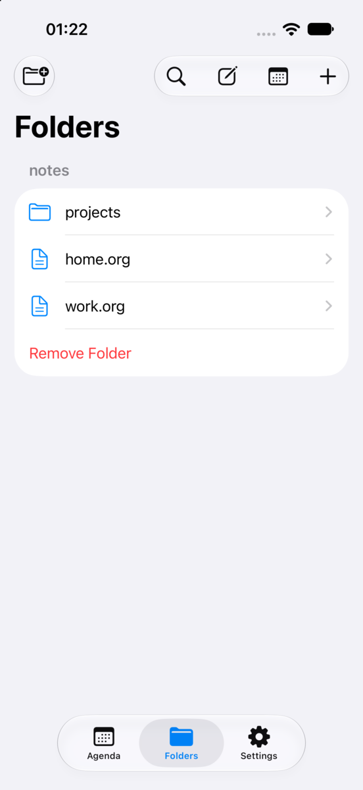
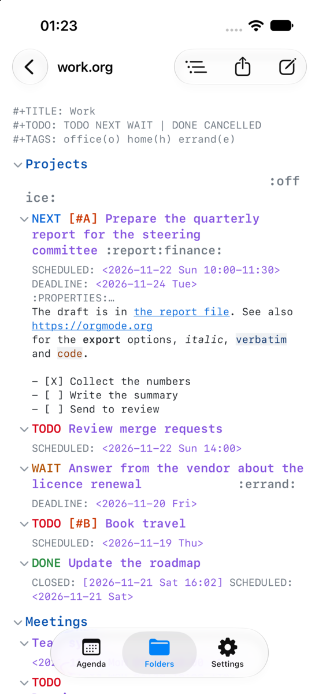

**C2. The board colours every open keyword red; the agenda and editor do not.** Medium. Screenshot.
The board uses `theme.keywordColor` (`Sources/Orgstar/BoardView.swift:96`, `:149`), the agenda `theme.todoColor` (`Sources/Orgstar/AgendaRowView.swift:36`). NEXT is blue and WAIT orange in the agenda and the editor, and both are red in the board.
Fix: use `todoColor` in the board.

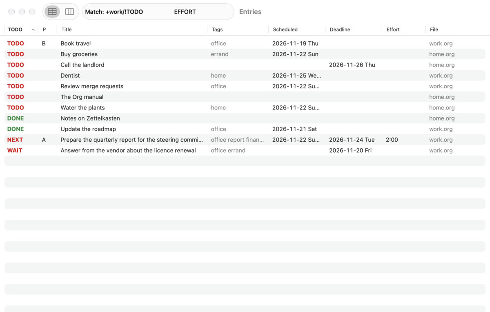

**C3. A prompt looks different in each Mac window.** Medium. Code.
The same `Prompt` is answered in the echo area in the main window (`Sources/Orgstar/Keys.swift:39-103`), in a system alert with the choices printed as one line of text in the agenda (`Sources/Orgstar/AgendaView.swift:385-393`), by raising the main window from the board (`Sources/Orgstar/BoardView.swift:208-214`), and in an inline row in column view (`Sources/Orgstar/ColumnViewSheet.swift:46-52`).
Fix: one prompt view with filtering and completion, hosted by each window.

**C4. Transient messages have four presentations on iOS.** Medium. Code.
Top inset with a 4-second timeout in the editor (`Sources/OrgstarMobile/EditorScreen.swift:219-226`), bottom inset with no timeout in the reader (`ReaderScreen.swift:117-122`), a glass capsule in the agenda and board (`AgendaScreen.swift:641-643`, `BoardScreen.swift:66-71`), and a material capsule with a fixed 150 pt bottom padding at the root (`OrgstarMobileApp.swift:233-242`).
Fix: one message view and one timeout.

**C5. Four wordings for "this command does not run here".** Medium. Code.
`"\(title) isn't available on iPhone and iPad."` (`MobileEditor.swift:358`), `"Not available on iOS yet"` with no command name (`MobileEditor.swift:396`, `:401`, `EditorScreen.swift:518`), `"Not available here"` (`EditorScreen.swift:480`), `"Nothing to do here"` (`MobileEditor.swift:370`). The second form does not say which command or where it does work.
Fix: one helper that takes the command title; keep the first form, and add "It runs on the Mac." where that is true.

**C6. View menu items do not state their state.** Medium. Code.
"Show or Hide Outline", "Show or Hide Backlinks", "Show or Hide Columns and Clock", "Truncate or Wrap Long Lines", "Turn Auto Fill On or Off" (`Sources/Orgstar/OrgstarApp.swift:531-538`), beside a real toggle for Show Markup in the same menu (`:536`) and a state-dependent title on the toolbar button (`Sources/Orgstar/ContentView.swift:213`).
Fix: `Toggle`s, or titles that follow the state as the toolbar button's does.

**C7. One thing, several names.** Low. Screenshot and code.
The Board command opens a window titled "Entries" or "Kanban" (`BoardView.swift:79`; iOS `BoardScreen.swift:73`). The inspector is "Columns and Clock" in the menu (`OrgstarApp.swift:534`), `app.toggle-inspector` as a command, and "Columns" and "Clock" as tabs (`InspectorPane.swift:16`). Capture is confirmed with "File" in the app (`CaptureScreen.swift:99`) and "Capture" in the share sheet (`Sources/OrgstarShare/ShareViewController.swift:129`). "Reminders" in iOS Settings is both the notification lead time (`SettingsScreen.swift:132`) and the Reminders app (`:233`).
Fix: one name each; call the lead-time section "Notifications".

**C8. Capitalisation is mixed.** Low. Screenshot and code.
iOS Settings has "Show days without entries", "Habits only today", "Blocked entries" beside "Show Calendar Events", "Light Theme", "TODO Dependencies" (`SettingsScreen.swift:54`, `:63`, `:84`, `:113`, `:166`). Key bar labels are "Move up", "Open link", "Act at point" (`EditorScreen.swift:839-872`) beside title-case menus. The catalog holds both cases of "Clocked in", "Conflicting Changes", "Node Graph", "Search Notes" and "Sync Conflict Copies".
Fix: title case for buttons, menu items and section headers, sentence case for toggles with a full phrase and for messages; remove the duplicate keys.

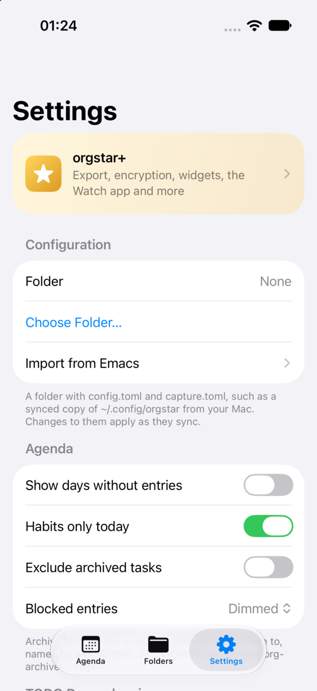

**C9. The agenda row is arranged differently on Mac and iOS.** Low. Screenshot.
On the Mac tags follow the title, the status icon sits under its label, and Overdue is a group inside Today. On iOS tags sit above the title beside the category, the icon leads the label, and Overdue comes before Today. Both read well; they are not the same design (`Sources/Orgstar/AgendaRowView.swift`, `Sources/OrgstarMobile/AgendaScreen.swift:950-975`).
Fix: choose one order for tags and for Overdue and use it on both.

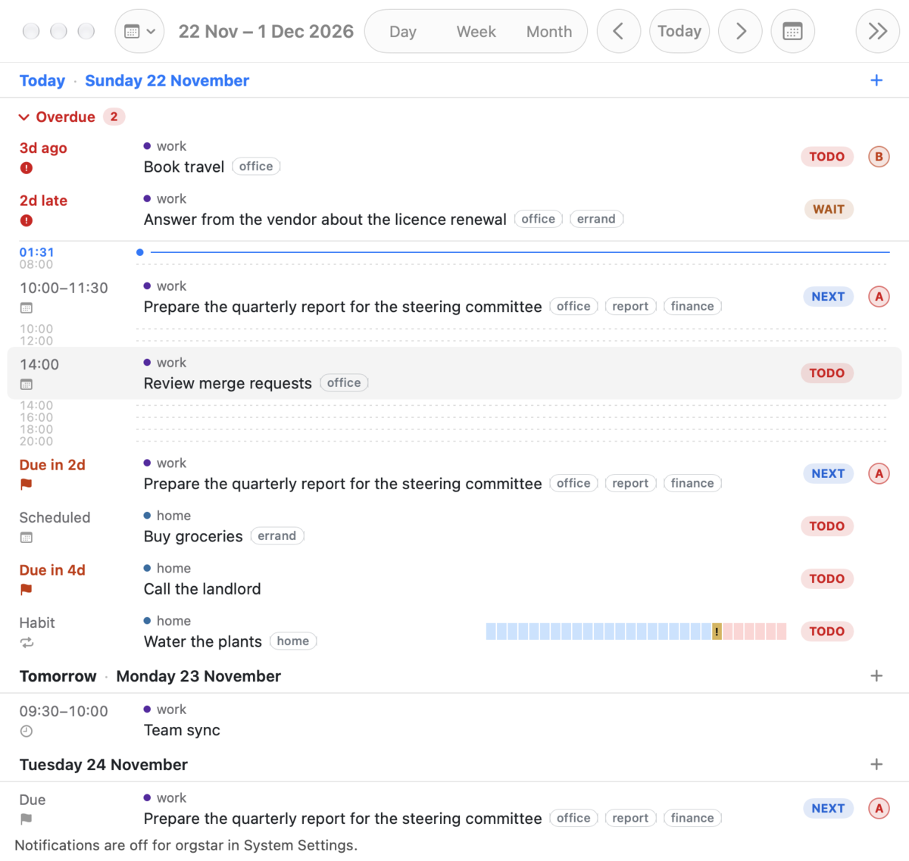
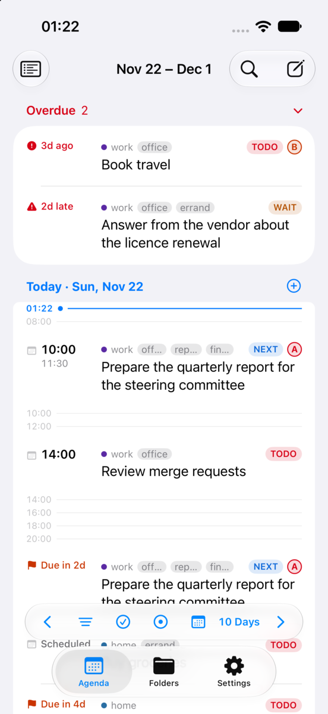

**C10. One symbol, several meanings.** Low. Screenshot and code.
`tablecells` is Column View and the Table menu, adjacent rows of More (`EditorScreen.swift:141`, `:143`). `chevron.left.forwardslash.chevron.right` is Code on the key bar and Show Markup in More (`:854`, `:150`). `calendar` is the Agenda tab, Schedule on the key bar, Daily Notes, and Go to Date. More is `ellipsis.circle` in the editor (`:137`) and `ellipsis` in the entry sheet (`EntrySheet.swift:76`).
Fix: one symbol per function; `eye` for Show Markup, `rectangle.split.3x1` for Column View.

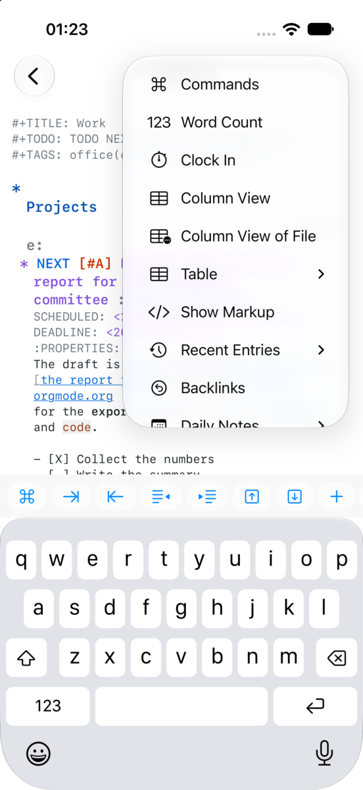

**C11. The running clock is shown twice on the Mac, in two formats, with an emoji.** Low. Code.
Toolbar: `"⏱ \(running.heading) \(clockElapsed(…))"` (`ContentView.swift:232`). Modeline: `"⏱ \(clockElapsed(…)) \(running.heading)"` (`Sources/Orgstar/ModeLine.swift:44`). Their menus differ.
Fix: keep one, as a `Label` with the `clock` symbol.

**C12. Hard-coded colours beside themed ones.** Low. Code.
Diff lines are `.red.opacity(0.18)` and `.green.opacity(0.18)` (`Sources/OrgApp/DiffView.swift:74-76`); the board's deadline is `.red` and its cards `controlBackgroundColor` on a themed background (`BoardView.swift:142`, `:193`, `:200`); watch rows are `.red`, `.orange`, `.green` (`Sources/OrgstarWatch/WatchApp.swift:176-179`), so every open keyword on the watch is orange. The Capture and Clock Report scenes get no theme or tint, unlike the other four (`OrgstarApp.swift:455-465` against `:408-444`).
Fix: theme colours throughout; carry the keyword colour in `WatchAgenda.Entry` as the widgets' snapshot does.

**C13. Sheets end differently.** Low. Code.
"Decide Later", "Close", "Close" (`Sources/Orgstar/VersionViews.swift:21`, `:58`, `:110`), "Done" as the cancel action (`ColumnViewSheet.swift:36`), "Done" as the default action (`PlotSheet.swift:30`). Titles are "Conflicting changes" and "Sync conflict copies" beside "Column View"; the recovery sheet has no title (`VersionViews.swift:92-103`).
Fix: "Done" as the default action on read-only sheets, title case, a title on every sheet.

**C14. `state-replace` is read but is not a theme slot.** Low. Code.
`Sources/Orgstar/Keys.swift:148` reads `theme.color("state-replace")`; `ThemeSpec.slots` (`Sources/OrgPresentation/ThemeSpec.swift:119-121`) has no such key, so REPLACE is always system red and a theme file that sets it is rejected.
Fix: add the slot.

## 4. Usability

**U1. On iPhone a heading with tags wraps inside the tag.** High. Screenshot.
Tags are padded with spaces to column 77 (`org-tags-column`, `Sources/OrgApp/UserConfig.swift:121`). A phone shows about 34 columns, so the padding wraps: the reader shows `:off` on one line and `ice:` on the next, and the editor leaves the star alone on the first line, the title on the second and the tag broken over two more. Nothing in `ReaderScreen.swift` or `MobileEditor+Styling.swift` treats the padding; the reader only colours tags (`ReaderScreen.swift:264`). Any file aligned by Emacs or by the Mac app looks like this.
Fix: draw the run of spaces before a heading's tags as a single flexible gap (tags right-aligned on the line when they fit, one space when they do not), in the reader and both editors. The file is not changed.

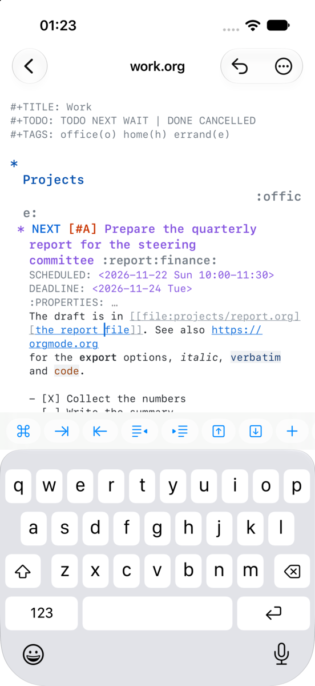

**U2. The reader and editor are monospaced throughout, and prose runs the full width.** Medium. Screenshot.
`theme.body-font` gives prose a proportional font and keeps tables, code, dates and tags fixed (`UserConfig.swift:340`), and `theme.text-width` caps the line (`:346`). Both default to off. The Mac has a picker for the first (`OrgstarApp.swift:930`); iOS Settings shows the font read-only (`SettingsScreen.swift:135`) and has no control for either, so on iPhone and iPad they can be set only by editing `config.toml`. With defaults, `#+TITLE:`, `:PROPERTIES:…`, `SCHEDULED: <2026-11-22 Sun 10:00-11:30>` and `- [X]` appear as typed, and on iPad a paragraph runs edge to edge in small fixed-pitch type.
Fix: add Body Font and Text Width to iOS Settings ▸ Appearance. Changing the defaults is a redesign question; see section 7.

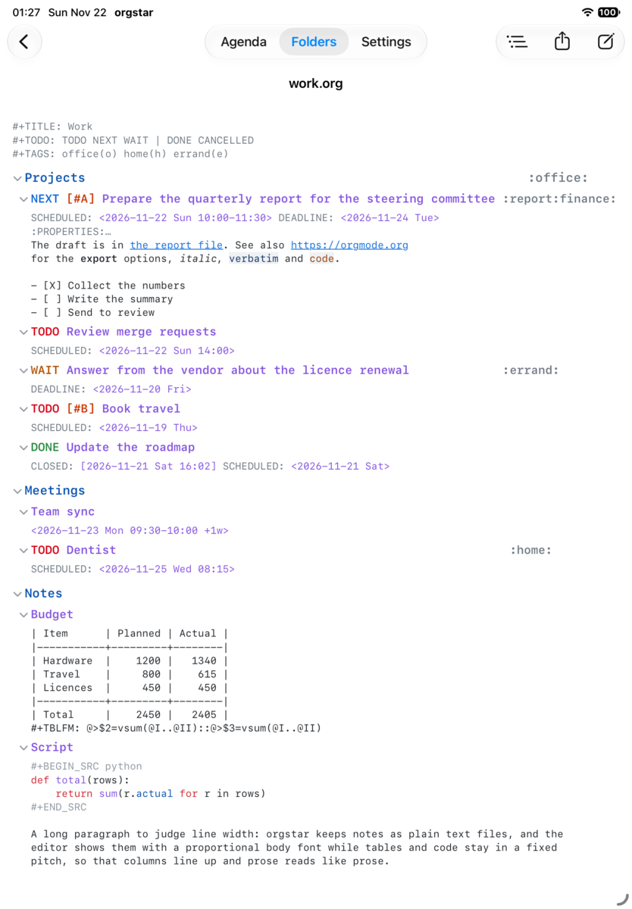
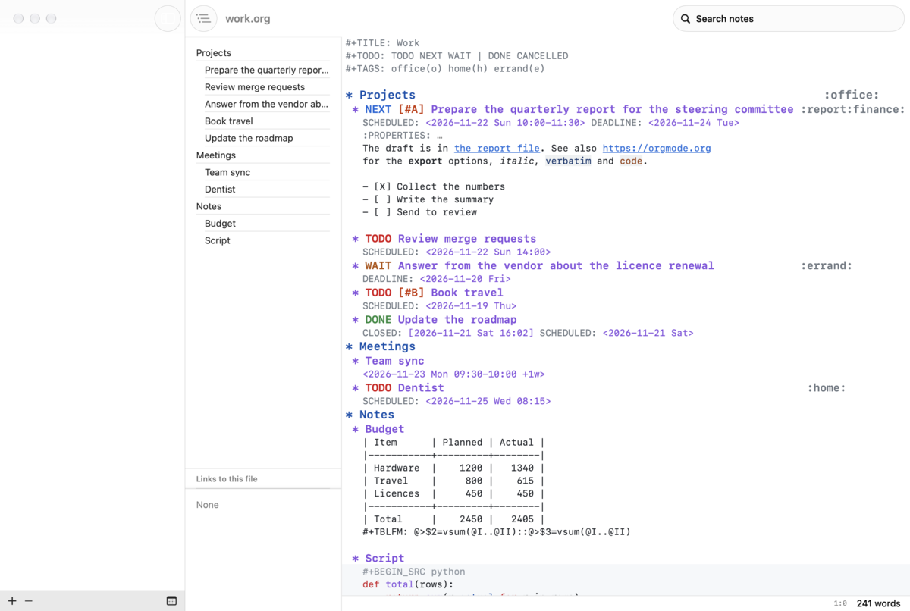

**U3. The Mac palette cannot be driven with the arrow keys.** High. Screenshot and code.
`PaletteView` handles only Return, which runs the first match (`Sources/Orgstar/Keys.swift:207-211`). No row is highlighted. Quick Open has a selection, arrows and C-n/C-p (`Sources/Orgstar/SearchViews.swift:36-58`).
Fix: share Quick Open's selection handling.

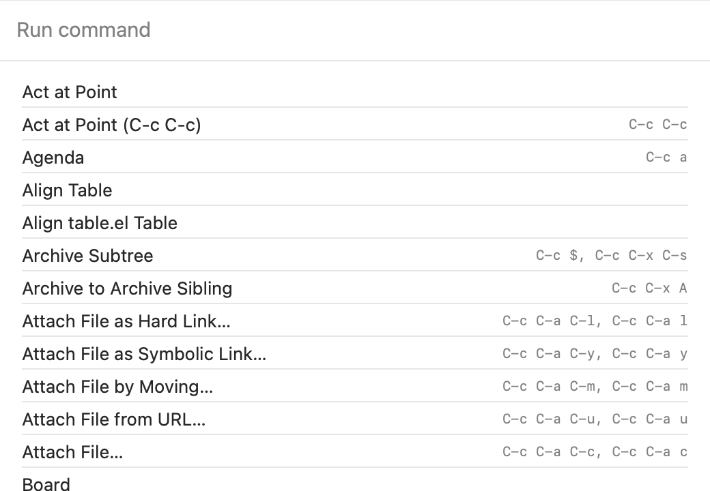

**U4. The palette lists commands that look like duplicates, and Emacs-internal names.** Medium. Screenshot.
"Act at Point" (`Sources/OrgCore/Commands/Dwim.swift:10`) and "Act at Point (C-c C-c)" (`Sources/OrgCore/Commands/CtrlCCtrlC.swift:13`) are adjacent; "Align table.el Table" follows. A key chord in a title is wrong in the Mac and Doom presets.
Fix: name them for what differs ("Act at Point" and "Update at Point", or hide one); drop chords from titles.

**U5. First run starts in Emacs keys and does not mention the palette.** High for people who do not come from Emacs. Screenshot.
The sheet's Keys picker defaults to Emacs (`Sources/Orgstar/WelcomeView.swift:13`) and its note reads "Org's own bindings: C-c C-t cycles TODO, C-c C-s schedules, M-RET makes a heading." Nothing names ⇧⌘P, the Org menu, Help or the manual (`:68-74`). The empty window names only ⇧⌘O and ⌘P (`ContentView.swift:191-193`).
Fix: see section 9.

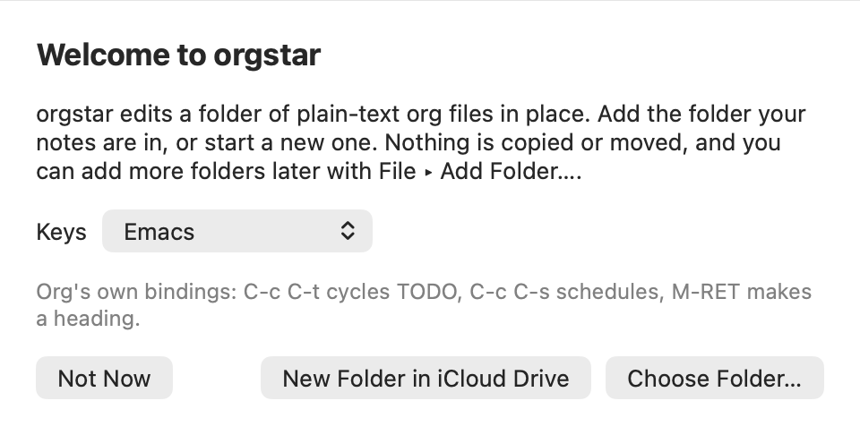

**U6. The Mac toolbar holds one button.** Medium. Screenshot and code.
Outline, plus the search field; the indexing spinner, clock and Conflict appear when they apply (`ContentView.swift:210-244`). Capture, Agenda, the inspector and the palette are menu-only, and the toolbar cannot be customised.
Fix: a customisable toolbar with Capture, Agenda, Commands and the inspector toggle.

**U7. The Org menu is one flat list.** Medium. Code.
`ForEach(EditorCommands.all.filter { $0.id.hasPrefix("org.") })` (`OrgstarApp.swift:607`): about a hundred items in registry order, with only Clock as a submenu (`:572`).
Fix: submenus by subject (Headings, TODO and Tags, Dates, Lists, Tables, Links, Blocks).

**U8. Help has no route to the manual.** Medium. Code.
The only addition is "What's New in orgstar" (`OrgstarApp.swift:587-590`). Nothing replaces the system's help item, and no build script or plist sets a help book, so the default item has nothing to open. What it shows was not observed.
Fix: replace it with "orgstar Manual" (the site) and "Keys" (the manual's key table for the active preset).

**U9. Echo-area messages vanish after four seconds and leave no record.** Medium. Code.
`AppCommands.show` clears the message after `Task.sleep(for: .seconds(4))` (`OrgstarApp.swift:171-179`). Refusals and export errors go there, on one line.
Fix: keep an error until the next key or click, and add a Messages command that lists recent ones.

**U10. Echo-area choices stop at twelve with no sign of more.** Medium. Code.
`ForEach(matches.prefix(12), …)` (`Keys.swift:47`); the first match is marked only by primary against secondary colour (`:53`) and there is no arrow-key selection.
Fix: a selectable list with an "n more" line; done with C3.

**U11. The iPhone agenda puts two floating bars over the list.** Medium. Screenshot.
The agenda bar (Earlier, Filter, Select, Today, Go to Date, span, Later; `AgendaScreen.swift:646-670`) floats above the tab bar. Together they cover about an eighth of the screen, and five of the seven controls are icons whose meaning is not evident (a circled dot for Today, a circled check for Select).
Fix: keep Earlier, Today, Later and the span in the bar; move Filter, Select and Go to Date into the Views menu at the top left.

**U12. Agenda tags truncate to three letters.** Medium. Screenshot.
A row with three tags shows "off…", "rep…", "fin…" at the default text size on an iPhone 17 (`AgendaScreen.swift:965-969`, `lineLimit(1)` in one `HStack` with the category and the keyword).
Fix: let the tag line wrap, or show two tags and "+1".

**U13. iOS has no find in the file.** High. Code.
The editor toolbar is Conflict, Undo and More (`EditorScreen.swift:132-137`); More has no search row; the reader's toolbar is Outline, Export and Edit (`ReaderScreen.swift:107-112`). Search exists only as "Incremental Search" in Commands.
Fix: a Find button in both toolbars, using the system find interaction.

**U14. The iOS Commands list is flat and speaks Emacs.** Medium. Screenshot and code.
It opens on "Cycle Global Visibility", Undo, Redo and nine clock commands. There are no sections and no recents; search matches a substring of the title (`EditorScreen.swift:1140`); the trailing hint is an Emacs chord such as `C-c C-x C-i` (`:1150-1152`) on a device with no Control key; rows are drawn in the tint colour like links.
Fix: see section 8.

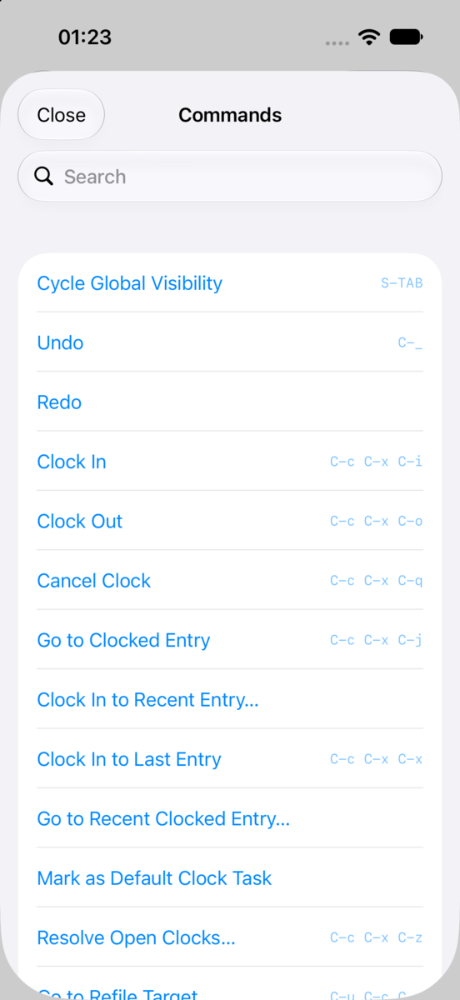

**U15. Settings open on configuration plumbing.** Medium. Screenshot.
iOS Settings starts with "Configuration: Folder None, Choose Folder…, Import from Emacs" and a footnote about `config.toml` and `~/.config/orgstar` (`SettingsScreen.swift:36-42`); Appearance is the sixth section (`:108`). Mac Settings ▸ General starts with the same two rows. Mac Settings ▸ Editing labels options by Emacs key and variable in every preset: "M-RET adds the new heading after the subtree", "M-q fills to column", "Emacs hides emphasis markers (org-hide-emphasis-markers)" (`OrgstarApp.swift:860-873`). iOS explains two toggles with variable names only (`SettingsScreen.swift:86`).
Fix: Appearance and Agenda first, configuration files last; label options by what they do, with the active preset's key from `keyLabel(for:)` and the variable name in the help text.

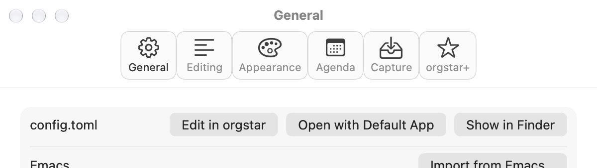

**U16. Onboarding's permission pages cannot be skipped.** Medium. Screenshot and code.
Notifications, Calendar and Reminders each offer only Continue, which raises the system prompt (`Sources/OrgstarMobile/OnboardingScreen.swift:88-125`); only the folder page has Later. Calendar and Reminders in the agenda are orgstar+ features (`Sources/OrgApp/ProAccess.swift:20`), which the pages do not say.
Fix: a "Not Now" on each; say on the two pages that the feature needs orgstar+, or ask when it is first turned on.

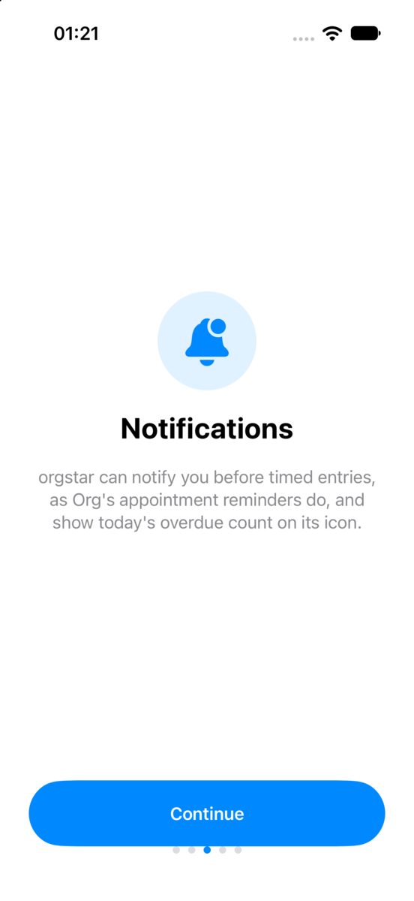

**U17. "Remove Folder" is a permanent red row with no confirmation.** Medium. Screenshot and code.
It is the last row of every folder's file list and calls `workspace.removeRoot` directly (`Sources/OrgstarMobile/FoldersScreen.swift:25`). It removes the folder from orgstar, not from disk, but the row does not say so and sits where a file would.
Fix: move it to a swipe action and context menu on the section header, with "Remove from orgstar" as the label.

**U18. The iPad runs the iPhone layout, without keyboard shortcuts.** Medium. Screenshot and code.
`TabView` and `NavigationStack` on every size (`OrgstarMobileApp.swift:190-209`); no `NavigationSplitView` or sidebar-adaptable tabs anywhere in `Sources/OrgstarMobile`. Agenda rows span 820 pt with the keyword at the far edge. There is no `keyboardShortcut`, `UIKeyCommand` or `.commands` in the target, so Capture, Search, tab switching and Commands have no ⌘ key and the iPadOS menu bar has no entries of the app's own. Split panes cannot be resized (`EditorSplitScreen.swift:115-128`).
Fix: on regular width, a sidebar with Agenda views and Folders beside the content; a `.commands` block that mirrors the Mac's File, View and Org menus.

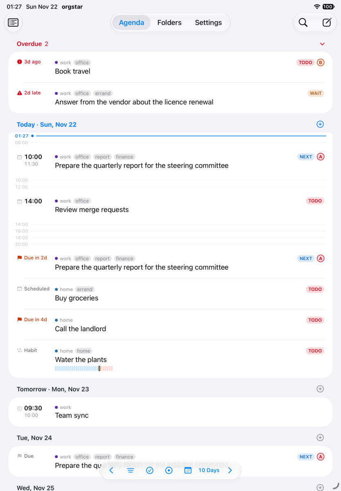

**U19. The orgstar+ screen spins forever when products fail to load.** Medium. Code.
`ProgressView` shows whenever `store.products.isEmpty` (`Sources/OrgstarMobile/ProScreen.swift:71-73`); the failure text appears in another section with no retry, while the tip section has "Try Again" (`TipSection.swift:31-33`).
Fix: spinner only while loading; the error with Try Again in its place.

**U20. A file not yet downloaded from iCloud does nothing when tapped.** Medium. Code.
`Label(name, systemImage: "icloud.and.arrow.down").foregroundStyle(.secondary)` with no action (`FoldersScreen.swift:305-307`).
Fix: tap starts the download and shows progress.

**U21. Empty states are missing in places.** Low. Code and screenshot.
A Mac agenda TODO or match list with no rows shows only its header (`AgendaView.swift:322-328`; the overlay covers only "no files", `:358-362`); the board has no empty state (`BoardView.swift:54-89`); the recovery sheet shows an empty list (`VersionViews.swift:94-108`). On the watch, "Open orgstar on your iPhone to show your agenda here." is a list row under the Capture field and looks tappable (`WatchApp.swift:151`).
Fix: `ContentUnavailableView` in each; on the watch, show the hint alone until the phone has sent an agenda.

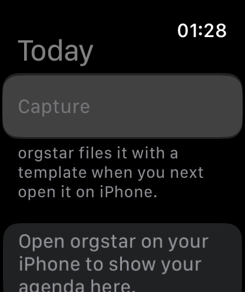

**U22. Every Mac error is an alert titled "orgstar".** Low. Code.
`.alert("orgstar", isPresented: errorShown)` with OK only (`ContentView.swift:492-499`).
Fix: title it with what failed.

**U23. The share extension hides failures.** Low. Code.
A failed write is `try?` followed by `completeRequest` (`ShareViewController.swift:21`, `:24`), so it looks like success. "orgstar's shared folder isn't available." (`:110`) gives no next step.
Fix: keep the sheet open with the error; add "Open orgstar once, then try again."

**U24. Small gaps.** Low. Code.
Redo has no button on iOS (Undo is in the toolbar, `EditorScreen.swift:136`). The pane refusal "Attempt to delete the only pane" is computed and dropped (`EditorSplitScreen.swift:52`, `:108`). The Mac sidebar accepts no drops: the only drop targets in `Sources/Orgstar` are the board's (`BoardView.swift:156`, `:175`). Paid items are marked in one place ("Agenda Files to iCalendar (orgstar+)", `ExportMenu.swift:187`) and unmarked elsewhere in the same menu.
Fix: Redo on a long press of Undo; show the pane message as "This is the only pane."; accept folder drops on the sidebar; one orgstar+ marker.

## 5. Accessibility

**A1. The iPhone agenda breaks at accessibility text sizes.** High. Screenshot.
At the first accessibility size the time "10:00" wraps to "10:0" and "0", grid labels overlap the now line, and tags shrink to one letter. At the largest size the status icon overlaps its label, tags are empty pills, the priority ring is clipped, and the bottom bar's icons overlap each other and the span. The causes are fixed dimensions beside scaling text: the 82 pt gutter (`AgendaScreen.swift:952`), the 18 pt priority ring (`:1005`), 14 and 16 pt row heights for grid and now lines (`:1081`, `:1101`), and a bar that does not wrap (`:646-670`).
Fix: `@ScaledMetric` for those dimensions; at accessibility sizes stack the gutter above the title and collapse the bar into a menu.

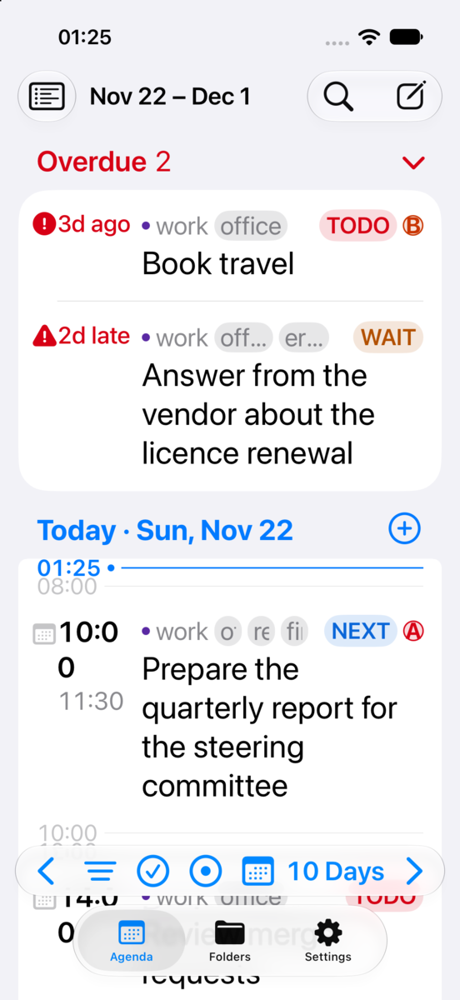
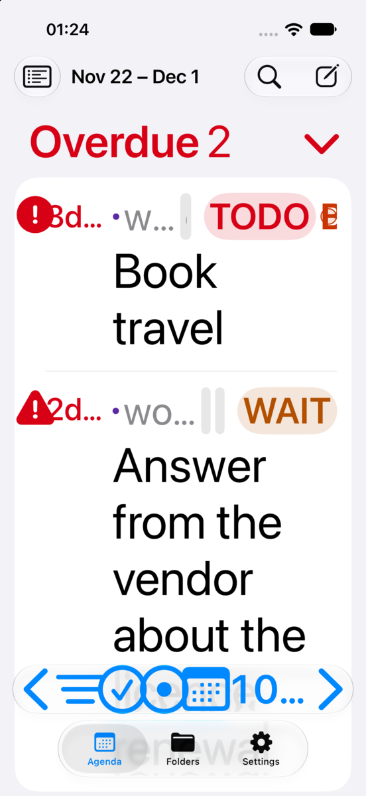

**A2. Key bar targets are under 44 pt and the bar does not scale.** High. Code and screenshot.
The bar is a hosting view fixed at 48 pt high with `sizingOptions = []` (`EditorScreen.swift:811-813`); its buttons are bordered, icon-only, with 6 pt vertical padding (`:874-877`), which leaves about 36 pt. Seventeen of the eighteen are icons without text.
Fix: 44 pt minimum height, a bar height from the content size category; see section 8 for which buttons stay.

**A3. Secondary text is under 3:1 in six of sixteen themes.** High. Computed.
Every ported palette maps tags, comments, keywords, drawers and planning lines, markup, block delimiters, line numbers, cancelled keywords, agenda times and sidebar headers to its `dim` colour (`Sources/OrgPresentation/Palettes.swift:133-144`).

| Theme | `dim` on background | Ratio | On block or sidebar background |
|---|---|---|---|
| doom-one | #5b6268 on #282c34 | 2.26 | 2.51 |
| Nord | #616e88 on #2e3440 | 2.43 | 1.96 |
| Solarized Light | #93a1a1 on #fdf6e3 | 2.48 | 2.18 |
| Tokyo Night | #565f89 on #1a1b26 | 2.76 | 2.91 |
| Solarized Dark | #586e75 on #002b36 | 2.79 | 2.42 |
| Catppuccin Latte | #8c8fa1 on #eff1f5 | 2.83 | 2.63 |

Between 3 and 4.5: Dracula 3.03, Tomorrow 3.22, Gruvbox Light 3.24, Gruvbox Dark 4.02, Paper 4.25, Catppuccin Mocha 4.44. The file's own comment sets 3:1 as the target and darkens only accent colours (`Palettes.swift:68-70`).
Fix: a separate `secondary` role at 4.5:1 or more for the slots that are text (tags, comments, planning lines, agenda times); keep `dim` for line numbers and markup characters.

**A4. The Vim state tag draws white on the theme colour.** High on the Mac in Doom keys. Computed and code.
`.foregroundStyle(.white)` (`Sources/Orgstar/Keys.swift:130`) over `state-normal`, `-insert`, `-visual`. White on those fills is 1.37 to 2.84 in Dracula, Catppuccin Mocha, Modus Vivendi, Tokyo Night, Nord, Gruvbox Dark and doom-one (Dracula INSERT #50fa7b: 1.37).
Fix: draw the label in the theme's background colour, which is 4.4 to 13 on the same fills in those themes.

**A5. The Mac echo area is silent to VoiceOver.** High. Code.
No file under `Sources/` posts an accessibility announcement (`AccessibilityNotification`, `NSAccessibility.post`, `UIAccessibility.post`: no matches). Command results and refusals are a transient `Text` (`Keys.swift:104-109`); the iOS message views are the same.
Fix: post an announcement from `AppCommands.show` and from the iOS message view.

**A6. No accessibility display setting is read.** Medium. Code.
A search of `Sources/` for `reduceMotion`, `colorSchemeContrast`, `IncreaseContrast`, `differentiateWithoutColor` and `reduceTransparency` finds nothing. Affected: keyword pills at 10 pt bold on a 14 % tint of their own colour (`AgendaRowView.swift:38-42`; iOS `AgendaScreen.swift:995-998`), tag outlines at 0.5 pt and 35 % (`AgendaRowView.swift:150`), the selection tint (1.25 to 2.16 against the background in every theme), the diff (red and green tint plus a leading "+" or "-" only, `DiffView.swift:65-76`), the habit graph (state by colour alone, `Sources/OrgstarWidgets/HabitsWidget.swift:129-144`), and the move transitions in onboarding (`OnboardingScreen.swift:37`, `:138`).
Fix: under Increase Contrast, solid pill fills, `fg` for `dim` slots and a stronger selection; under Reduce Motion, a cross-fade; label diff lines and habit days in words.

**A7. The default light theme has four roles under 4.5:1.** Medium. Computed.
`done` #248a3d 4.40, `agenda-today` #007aff 4.02, `todo-cancelled` #8e8e93 3.26, and `markup`, `block-delimiter`, `line-number` #8c959f 3.04 (`ThemeSpec.swift:156-166`). Default dark: the last three at 4.12 (`:178-179`).
Fix: #1a7f37 for `done`, #0969da for `agenda-today`, #6e7781 for the greys.

**A8. Solarized misses 4.5:1 almost everywhere.** Medium. Computed.
Body text is 4.99 (light) and 5.61 (dark), and 3.98 and 3.44 on a selection; coloured roles are 3.41 to 4.29 (light) and 3.25 to 4.08 (dark) (`Palettes.swift:73-75`, `:96-98`).
Fix: keep it as the upstream palette and say "low contrast" in the theme picker; A3's `secondary` role covers the worst of it.

**A9. Agenda and widget type is fixed-size and small.** Medium. Code.
The Mac agenda sets sizes from 8 to 13 pt with `.font(.system(size:))` (`AgendaRowView.swift:38`, `:73`, `:79`, `:114`, `:130`, `:137`, `:146`, `:161`, `:182`; grid labels 10 pt tertiary in a 10 pt row, `AgendaView.swift:479-486`). The Today widget draws 9 pt bold badges and a 72 pt gutter (`Sources/OrgstarWidgets/TodayWidget.swift:130`, `:134`, `:143`).
Fix: text styles (`.body`, `.caption`, `.caption2`) and `@ScaledMetric` widths.

**A10. Mac tabs, board cards and inspector rows are not reachable from the keyboard.** Medium. Code.
A tab is an `HStack` with `.onTapGesture` (`Sources/Orgstar/BufferTabs.swift:77`) and its close button is 12 by 12 pt (`:64`). Board cards open on a double tap gesture (`BoardView.swift:157`) and inspector rows on a tap gesture (`InspectorPane.swift:75`, `:109`); kanban has no key to move a card. The outline divider is a 7 pt strip hidden from accessibility (`BufferTabs.swift:17`, `:26`).
Fix: `Button`s or list selection; a 20 pt hit area for close; move-left and move-right keys on the board.

**A11. Onboarding pages do not scroll.** Medium. Code.
Each page is a `VStack` with spacers and a 96 pt symbol (`OnboardingScreen.swift:147-160`); at large text sizes the welcome page's three features cannot fit. Not screenshotted.
Fix: a `ScrollView` with the actions pinned below it.

**A12. Complications and widget rows lack labels.** Low. Code.
Watch complications have no `accessibilityLabel` (`Sources/OrgstarWatchWidgets/WatchWidgets.swift:63-70`; the iOS twin has one, `UpNextWidget.swift:56`). The habits widget says "Done N of M days" and drops today's state (`HabitsWidget.swift:129-130`). A wide Today row is not one element (`TodayWidget.swift:124-151`).
Fix: one combined label per row and complication.

## 6. Polish

**P1. Mac strings that never reach the string catalog.** Medium. Code.
`AppCommands.show(_ text: String)` takes a `String`, so "No file is open", "Not an org file", "Keymap reloaded" and "Attempt to delete the only pane" (`ContentView.swift:563`, `:1248`, `:1313`, `:1279`) are not in `l10n/Localizable.xcstrings`. The unsaved-changes alert (`OrgstarApp.swift:279-283`, `:299-303`), the inspector's tabs and spans (`InspectorPane.swift:16-17`, `:33`, `:92`) and the modeline's "Read-only", "BOM", "CRLF" (`ModeLine.swift:158-160`) are likewise English in German.
Fix: `String(localized:)` at each, then `scripts/sync-strings.sh`.

**P2. Widgets, Controls and complications fall back to English.** Medium. Code.
The Today widget's empty rows pass a `String` to `Text` (`TodayWidget.swift:88-90`), so "Nothing left today" and "Nothing scheduled" are not translated there although the catalog has them. Controls: "Capture", "Clocked in", "In: …", "No recent clock", "First template" (`Sources/OrgstarWidgets/Controls.swift:12`, `:26`, `:91`). Complications: "Agenda clear", "N open today", "Open orgstar" (`WatchWidgets.swift:62-76`). "In: <heading>" is also unclear; the watch says "Clock In to …" (`WatchApp.swift:124`).
Fix: `LocalizedStringKey` or `String(localized:)` for each; "Clock In to %@" in the control.

**P3. Plurals are built in code on iOS.** Medium. Code.
`"\(copies) sync conflict \(copies == 1 ? "copy" : "copies")…"` (`EditorScreen.swift:444`), "entry"/"entries" and "was"/"were" (`AgendaScreen.swift:871`), "Archive \(marked.count) entries?" (`:206`); " / month" and " / year" are plain strings (`ProScreen.swift:157-158`).
Fix: plural variants in the string catalog.

**P4. German: two truncations seen, several long strings.** Medium. Screenshot and code.
The Mac agenda's toolbar title is cut to "22 Nov. – 1 Dez. 2…" at the window's default width. On iPhone "2d überfällig" is scaled down beside "vor 3d" (`minimumScaleFactor(0.8)` in the 82 pt gutter, `AgendaScreen.swift:1042-1044`), so two status labels in one list have different sizes. Long translations in tight places, not seen truncated: "Clock Out" is "Zeiterfassung beenden" in the Live Activity button, the Mac toolbar and the watch (`ClockActivityWidget.swift:69`, `ContentView.swift:223`, `WatchApp.swift:119`); "Use Disk Version" is "Version auf der Festplatte verwenden" (`VersionViews.swift:23`).
Fix: drop the year from the Mac title when it is the current year; a scaled gutter (A1); "Ausstempeln" and "Datei-Version verwenden".

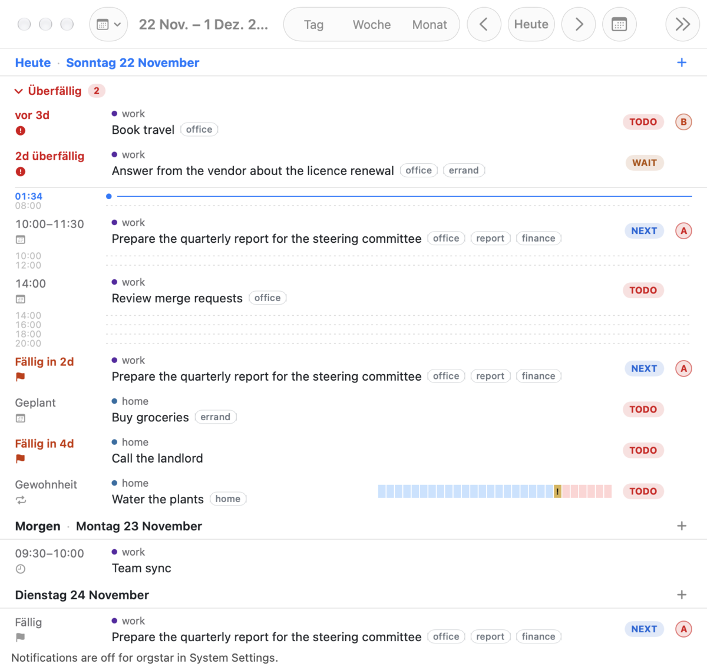
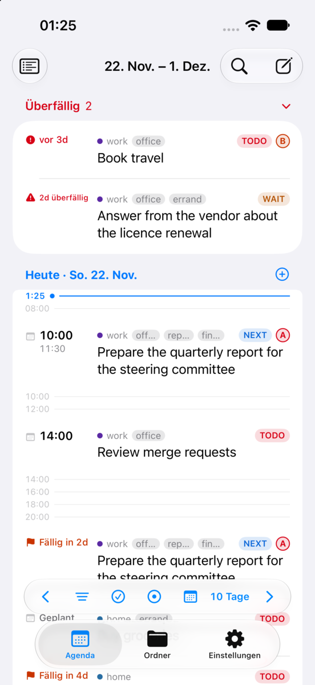

**P5. The agenda's time grid reads as clutter.** Low. Screenshot.
Grid labels stack at 10 to 14 pt row height, so "14:00 16:00 18:00 20:00" is a block of four tight lines, the "10:00" grid line repeats directly under the 10:00 entry, and the now line sits against "08:00" (`AgendaView.swift:476-486`; `AgendaScreen.swift:1081`). It follows Org's time grid faithfully.
Fix: omit a grid line whose time an entry already shows, and give the rest the row spacing.

**P6. Small errors on first-run and capture.** Low. Screenshot and code.
The welcome text ends "File ▸ Add Folder…." with an ellipsis and a full stop (`WelcomeView.swift:28`). The Mac capture window says "Capture" in its title bar and again as its heading (`OrgstarApp.swift:461`, `CaptureView.swift:77`). iOS onboarding says "Your org files on iPhone" on iPad (`OnboardingScreen.swift:66`), and its page dots touch the bottom edge of the Continue button.
Fix: reword the sentence to end on the menu path; drop the heading; "on this device"; 12 pt between button and dots.

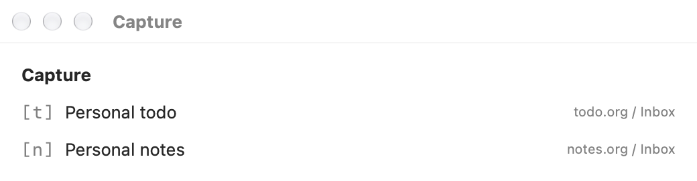

**P7. The Mac outline column spends space on an empty backlinks pane.** Low. Screenshot.
"Links to this file" with "None" takes the bottom fifth of the column by default (`Sources/Orgstar/BacklinksPane.swift:32`, `:41`), and every outline row has a full-width rule under it, which reads as a table, not a source list.
Fix: collapse the pane to its header when empty; no row separators in the outline.

**P8. The board's table truncates its date columns at their default width.** Low. Screenshot.
"2026-11-25 We…" in Scheduled (`BoardView.swift:106`, ideal width 110). The table shows ISO dates where the agenda shows "Due in 2d".
Fix: ideal width 130, or drop the weekday.

**P9. Home Screen widgets have no tinted-mode handling.** Medium. Code.
`widgetAccentable` appears only in `UpNextWidget.swift:52-66` and the watch widgets. In the tinted style the habit graph's four state colours become one tint (`HabitsWidget.swift:133-144`). Needs a device to see.
Fix: mark headers accentable; encode habit state by opacity steps in the accented mode.

**P10. Quick Look reads UTF-8 only at a fixed size.** Low. Code.
`Sources/OrgstarQuickLook/PreviewProvider.swift:13`, `:16`: other encodings throw a generic error; `contentSize` is 800 by 800.
Fix: fall back to Latin-1.

**P11. The manual has no pictures.** Medium. Code.
`docs/manual` holds only `.org` files, a six-line `style.css`, a favicon and two templates. A reader cannot see what the key bar, the agenda or the Mac window look like. Its typography and dark mode come from orgo's `docs` theme (`orgo.toml:8`), which is outside the repository and was not reviewed. It is English only (`orgo.toml:7`) while the app ships six languages.
Fix: one screenshot each for the Mac window, the iOS editor with the key bar, and the agenda.

**P12. App Store screenshots mix appearance and dates, and lead the editor with raw markup.** Low. Code and images.
Sets exist for iPhone 6.9" and 6.3", iPad, Mac and Watch, all English. The Mac editor shot is dark with November dates; `CONTRIBUTING.org` describes the demo as around 16 October and the iPhone and Watch shots are light and in October. `iphone-6.9/03-editor.png` shows `#+TITLE`, stars and `:LOGBOOK:` in monospace with the key bar cut off.
Fix: retake the Mac set from the demo folder as documented; shoot the editor with a body font and hidden stars; add a German set.

**P13. Icons.** No finding. The iOS icon and its twelve alternates each have dark and tinted variants; the watch and Mac icons are single images, and macOS derives the others.

## 7. Does any of this amount to a visible redesign?

No finding calls for redesigning the Mac window, the agenda or the visual language. They are sound, and the fixes in sections 3 to 6 change details a user would notice only as things working.

Four changes would be visible to every user on update:

1. **The iPad layout** (U18): a sidebar and split view on regular width, with a menu bar and shortcuts. This is new structure on one platform.
2. **Where commands live on iOS** (section 8): a shorter key bar, no More menu, Commands on every screen.
3. **Editor typography defaults** (U2): a proportional body font and a capped line width as the default for new installations, and tags drawn as a right-aligned gap (U1).
4. **The Mac for newcomers** (section 9): Mac keys as the default when no Emacs configuration is found, a toolbar with more than one button, a grouped Org menu.

None of the four changes file formats, settings or commands, and each can ship alone behind the existing settings. I judge that they do not justify moving 2.0.0 earlier: they fit minor releases (the iPad layout and the iOS command surface as the headline of one, the Mac changes with milestone 4), and 2.0.0 can stay where the first public API is. The exception would be a decision to change the typography defaults for existing users as well as new ones; that alters how every file looks on the day of the update and would deserve a major version. The recommendation is not to: apply new defaults to new installations only.

## 8. Recommendation for #135: where commands live on iOS

What is there now. The key bar has 18 buttons in one sideways-scrolling row, hard-coded (`EditorScreen.swift:834-872`): Commands, Fold, Overview, Promote, Demote, Move up, Move down, New heading or item, TODO, Act at point, Schedule, Deadline, Tags, Open link, Bold, Italic, Code, Hide keyboard. Eight are visible at once on an iPhone 17. More has 19 top-level rows and about 50 leaf items (`:137-207`), of which half are visible above the keyboard. Commands is a flat list reachable only from the editor, through the key bar or More. The reader and agenda have no entry to it. Every key bar function but Hide keyboard is also in Commands; about half of More is too; Redo, find, Refile and Archive are in Commands only.

Recommendation:

1. **The rule.** The key bar holds what is done repeatedly at the caret while typing. A toolbar button is for what acts on the file or screen as a whole and is needed often. Everything else is in Commands, and only there.
2. **The key bar: ten buttons that fit without scrolling on an iPhone 17**, at 44 pt. Commands, Fold, Promote, Demote, Move up, Move down, New heading or item, TODO, Act at point, Hide keyboard. Overview (a whole-file action) and Open link (a tap on the link does it) go to Commands. Schedule, Deadline and Tags go behind one "Plan" button with a three-row menu, or to Commands. Bold, Italic and Code move to the text selection's edit menu, where iOS users look for formatting. On iPad, where the bar is wider, the three planning buttons can stay.
3. **The same Commands button in the toolbar of the editor, the reader and the agenda**, with the `command` symbol, replacing More in the editor. In the reader and agenda the list holds the commands that apply to the heading or row in view.
4. **More goes away.** Its status items become what they already are elsewhere: Conflict is already a toolbar button when there is one (`:133-135`); Recovered Versions and Sync Conflict Copies appear as a toolbar button only when there is something to show, and are in Commands otherwise. Export is a share button in the editor toolbar as it is in the reader. Word Count, Clock In, Column View, Table, Backlinks, Daily Notes, nodes, Attachments, Encryption and Panes are found in Commands.
5. **Commands gains what makes that workable**: an empty query lists Recent (the last eight used), then sections by subject (Structure, TODO and Planning, Clock, Tables, Links and Notes, Attachments, Export, File); search is fuzzy as on the Mac; hints show only when a hardware keyboard is attached; commands that do not apply at the caret are shown dimmed with the reason, not hidden; rows are in the primary colour.
6. **Find and Redo get buttons** (U13, U24): Find in the editor and reader toolbars, Redo on a long press of Undo.

Order of work: 5 first (it makes Commands good enough to carry the load), then 3 and 6, then 2 and 4 together.

## 9. Recommendation for #138: finding commands in the Mac preset

What is there now. The palette opens with ⇧⌘P from File ▸ Command Palette… in every preset (`OrgstarApp.swift:474-475`); the Mac preset itself binds neither `app.palette` nor `editor.complete` (`Sources/OrgCore/Keymap/PresetMac.swift`, no occurrence of either). With an empty query the palette lists every command alphabetically (`Keys.swift:196-202`), with the preset's keys at the right. It ranks by fuzzy score alone and cannot be driven with the arrow keys (U3). The which-key panel appears 600 ms after a prefix key (`Keys.swift:23-35`, `:113-118`); every Mac preset binding is a single chord, so in that preset it never appears. The registry has 319 command titles (`Sources/OrgApp/CommandTitles.swift`); the menu bar shows the `org.` commands in one flat menu and about 35 hand-written items, so most `app.` commands (attach, encryption, nodes and daily notes, refile, archive, table import and export, plot) are in the palette only. The toolbar has one button. The first-run sheet does not mention any of this.

Recommendation:

1. **Complete at Point: ⌃Space** in the Mac preset. ⌃Space is what other Mac editors use. macOS assigns it to switching input sources, which takes effect only when the user has more than one, so also bind ⌥Esc, the system text completion key. Update the Mac column in `docs/manual/guide/03-keys.org:782`.
2. **Palette: recents, then frequency** (the content of #144). With an empty query show "Recent", the last ten commands run from any source, then the rest alphabetically. When ranking matches, add a bounded bonus for use count (for example `min(uses, 20)` scaled to at most the word-start bonus of 8 in `Sources/OrgApp/FileTree.swift:82-90`), so a frequent command wins a tie and never beats a clearly better match. Store counts per command identifier in `UserDefaults`, not in `config.toml`.
3. **Palette: selection and names.** Arrow keys and ⌃N/⌃P move a highlighted row and Return runs it (U3). Remove chords from titles and resolve the "Act at Point" pair (U4). Show a one-line description under the highlighted row where the registry has one.
4. **Mac keys by default when there is nothing to import.** The welcome sheet's picker defaults to Emacs; default it to Mac unless `~/.emacs.d`, `~/.config/emacs` or `~/.config/doom` exists. Add one line under the picker in every preset: "⇧⌘P finds any command. The Org menu lists them with their keys."
5. **The menu bar is the map.** Group the Org menu into submenus (U7), so a newcomer can read what the app does. Add the palette-only families as submenus of File and Org (Attachments, Encryption, Notes). Add Help ▸ orgstar Manual and Help ▸ Keys (U8); the system's Help search then finds every menu command by name, which the flat menu already allows but nobody discovers.
6. **Toolbar: Capture, Agenda, Commands, inspector**, customisable (U6). The Commands button gives the palette a visible entry for people who do not read menus.
7. **Echo area.** In the Mac preset it never shows key hints, so its job is results: keep errors until the next key (U9), and after a command run from the palette or a menu, show its key once ("Schedule: ⌃⌘S") so the preset teaches itself.
8. **Settings ▸ Editing in the preset's terms** (U15).

Items 1 to 3 are small and independent. Item 4 changes a default for new installations only.

## 10. Not looked at, and what needs a device

- **VoiceOver, Full Keyboard Access, Switch Control and Voice Control were not exercised.** A5, A10 and A12 are from code. The VoiceOver passes on the Mac and iOS (issues 3 and 4) are still owed and would find more.
- **Increase Contrast, Reduce Motion and Reduce Transparency were not switched on**; A6 rests on the absence of any code that reads them.
- **Mac menus, the sidebar's file list, context menus, drag and drop, focus rings, the tab bar with several files, the inspector, column view, the clock report, the conflict and recovery sheets and the echo area in use** were reviewed from source. The snapshot hook renders one window and no menus, and no screen capture was attempted.
- **Themes other than Default** were not seen on screen; the contrast figures are computed from the palette values.
- **iPad**: only portrait, one window. Split panes, Stage Manager, multiple windows, pointer hover and a hardware keyboard were not exercised. From code, `model.openRequest`, `agendaRequest` and `captureRequest` are on a singleton that every scene's root view consumes (`OrgstarMobileApp.swift:244-270`), so which window reacts to a deep link with two windows open should be checked on a device.
- **iPhone**: capture, the entry sheet, Search, the board, the orgstar+ and tip screens, export and the share sheet were reviewed from source, not seen.
- **Watch**: only the unpaired empty state was seen. Populated rows, the clock section and complications need a paired phone.
- **Widgets, Controls and the Live Activity** were not seen at all; P2, P9 and A12 are from code. Tinted and clear Home Screen styles and the Lock Screen need a device.
- **Quick Look and Spotlight** were not run.
- **German** was seen on four screens (iPhone agenda and Settings, Mac agenda and Settings). French, Japanese, Spanish and Portuguese were not looked at.
- **Motion and scrolling** were not judged; the machine was loaded.
- **One launch observation to check on a device.** The first two launches after the simulator booted showed a blank white screen for 15 to 30 seconds. A sample put the main thread in `MobileModel.init` → `ClockModel.remindAtEffort` → `SystemReminderCenter.remove` → `UNUserNotificationCenter.removePendingNotificationRequests`, waiting on a synchronous reply (`Sources/OrgstarMobile/MobileModel.swift:102`, `Sources/OrgApp/ClockModel.swift:259`, `Sources/OrgApp/ReminderScheduler.swift:113`). Later launches took about a second, so the wait was the simulator's notification service starting under load. The call is still made from `App.init` before the first frame, and belongs after it.
- **The manual site's theme** is orgo's and outside this repository.

## 11. Proposed issues

One line each; the findings they cover are in brackets. "1.2.x" marks those small enough for a patch release.

Accessibility
1. iOS agenda: lay out for accessibility text sizes [A1] high
2. iOS key bar: 44 pt targets and a bar that scales [A2] high, 1.2.x
3. Themes: a secondary text role at 4.5:1 [A3, A7, A8] high, 1.2.x
4. Mac: state tag text colour from the theme background [A4, C14] high, 1.2.x
5. Announce echo-area and message text to VoiceOver [A5] high, 1.2.x
6. Honour Increase Contrast, Reduce Motion and Differentiate Without Colour [A6] medium
7. Agenda and widgets: text styles instead of fixed sizes [A9] medium
8. Mac: keyboard access to tabs, board cards and inspector rows [A10] medium
9. iOS onboarding: scrolling pages, skippable permissions [A11, U16] medium, 1.2.x
10. Accessibility labels for complications and widget rows [A12] low, 1.2.x

Usability
11. Draw heading tags right-aligned without wrapping inside the tag [U1] high
12. iOS: Find in the editor and reader [U13] high
13. Mac palette: arrow-key selection, clearer names [U3, U4] high, 1.2.x
14. iOS Settings: Body Font and Text Width [U2] medium, 1.2.x
15. Mac: first run for people without Emacs [U5] medium, 1.2.x (part of #138)
16. Mac: customisable toolbar, grouped Org menu, Help ▸ Manual [U6, U7, U8] medium (part of #138)
17. Mac echo area: keep errors, list recent messages, selectable choices [U9, U10, C3] medium
18. iOS agenda: one bottom bar, tags that do not truncate to three letters [U11, U12] medium
19. Settings: appearance first, options named by what they do [U15] medium
20. iOS Folders: Remove Folder as a swipe action; download iCloud files on tap [U17, U20] medium, 1.2.x
21. iPad: sidebar layout, menu bar and keyboard shortcuts [U18] medium
22. orgstar+ screen: error and retry instead of a spinner [U19] medium, 1.2.x
23. Empty states for agenda lists, the board, recovery and the watch [U21] low, 1.2.x
24. Error alerts and share-sheet failures say what failed [U22, U23] low, 1.2.x
25. iOS: Redo, the pane message, one orgstar+ marker; Mac: folder drops on the sidebar [U24] low

Consistency
26. Distinct icons for Capture and Edit, and one symbol per function [C1, C10] medium, 1.2.x
27. Board: keyword colours as in the agenda; theme colours in the diff, board and watch [C2, C12] medium, 1.2.x
28. iOS: one message view and one refusal wording [C4, C5] medium, 1.2.x
29. Mac View menu: toggles that state their state [C6] medium, 1.2.x
30. One name per thing, one capitalisation rule, one way to end a sheet [C7, C8, C13] low, 1.2.x
31. One agenda row layout on Mac and iOS [C9] low
32. Mac: one running-clock display [C11] low, 1.2.x

Polish
33. Mac: route echo-area, alert, inspector and modeline strings through the catalog [P1] medium, 1.2.x
34. Widgets, Controls and complications: localized fallbacks [P2] medium, 1.2.x
35. iOS: plural variants in the string catalog [P3] medium, 1.2.x
36. German: agenda title, gutter labels and long clock strings [P4] medium, 1.2.x
37. Agenda time grid: drop redundant lines [P5] low
38. First-run and capture wording; outline column; board column widths [P6, P7, P8] low, 1.2.x
39. Widgets: tinted and accented rendering [P9] medium
40. Quick Look: other encodings [P10] low, 1.2.x
41. Manual: screenshots [P11] medium
42. App Store screenshots: one appearance, demo dates, a readable editor shot, German [P12] low
43. iOS: move the notification clean-up out of `App.init` [section 10] low, 1.2.x

#135 and #138 carry the work in sections 8 and 9; issues 13, 15 and 16 can be closed into #138 if it is preferred as one issue.
